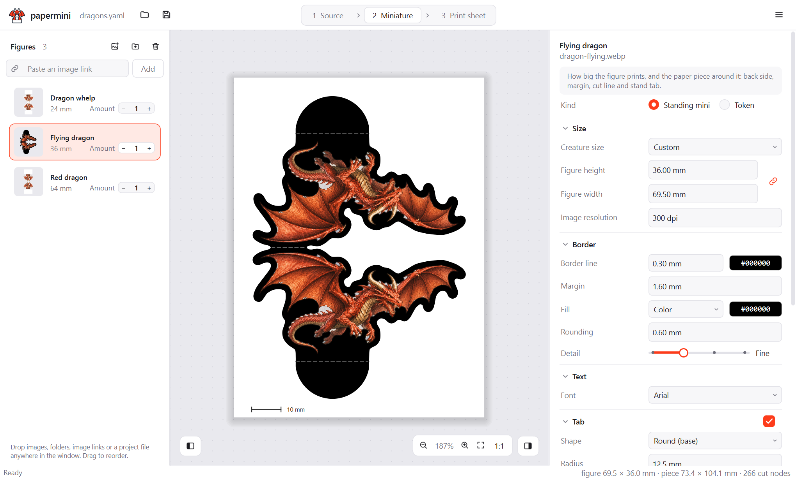
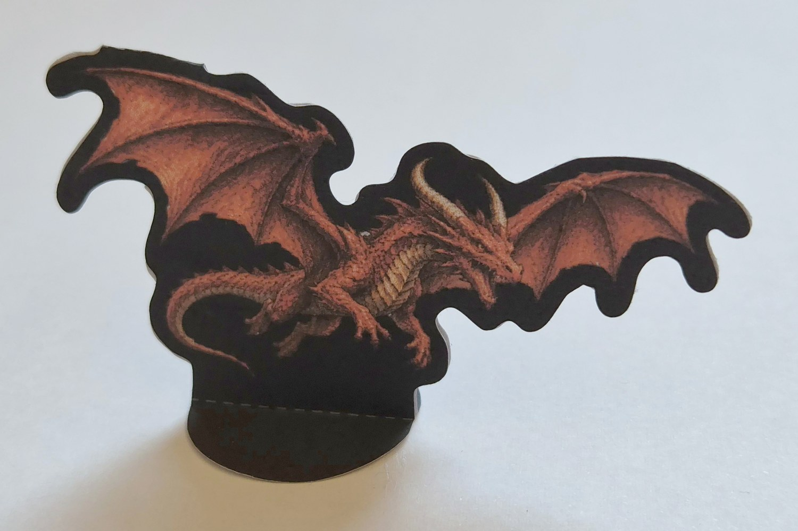
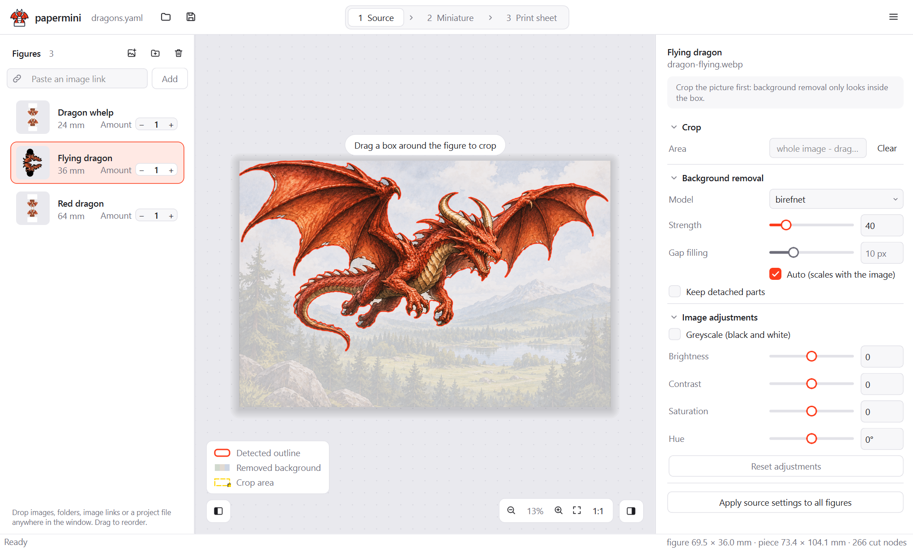
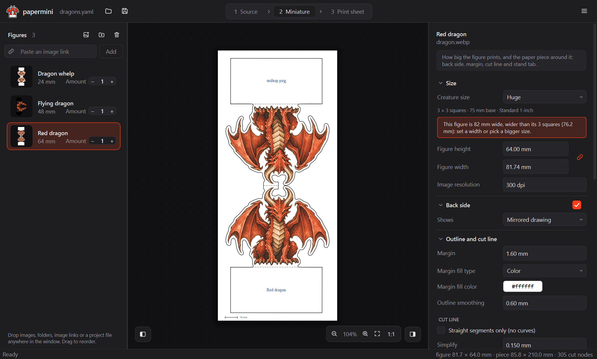
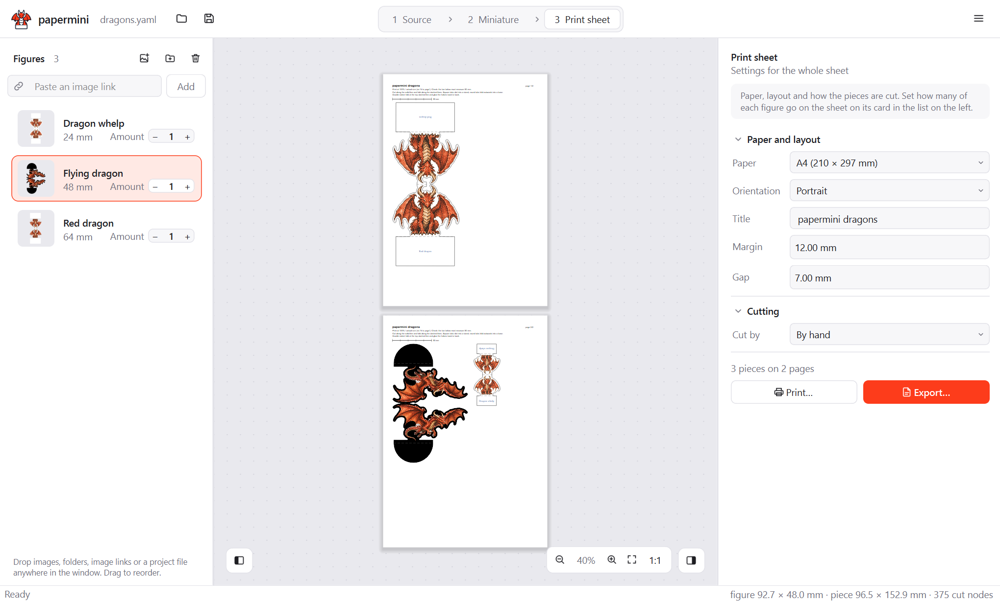

# papermini

Turn images (PNG/JPG) into **print-ready paper miniatures** for tabletop games like D&D (Dungeons & Dragons).

*Disclaimer: This tool is 100% vibecoded!*



<p align="center"><b>⬇️ Printed, cut out and folded, this is the mini made above ⬇️</b></p>

<p align="center">
  
</p>

**Contents**

- [Features](#features)
- [Quick start](#quick-start)
- [Usage via GUI](#usage-via-gui)
- [Usage via CLI](#usage-via-cli)
- [Development](#development)
  - [Run from source](#run-from-source)
  - [Set up your environment](#set-up-your-environment)
  - [Versions and releases](#versions-and-releases)
  - [Building the binaries locally](#building-the-binaries-locally)
- [Settings guide](docs/reference.md#settings-guide): every setting, with
  pictures (in the reference)

# Features

- **[Background removal](docs/reference.md#background-removal)**: AI models that run on
  your own computer, or the image's own transparency.
- **[Cropping](docs/reference.md#crop)**: drag a box to keep only the figure.
- **Cut line**: a smooth vector outline with a margin, for scissors or a knife.
- **[Cutting machines](docs/reference.md#cutting-by-machine)**: a sheet with
  alignment marks, plus a cut file with the cut lines and the same marks.
- **[Creature sizes](docs/reference.md#creature-sizes)**: Tiny to Gargantuan
  fill in the height and the base, from a size table for your grid.
- **[Stand tab](docs/reference.md#stands-and-bases)**: square to slot into a
  stand, or round to fold out into a base.
- **[Double-sided](docs/reference.md#double-sided-minis)**: a mirrored, blank
  or text back, folded over the head.
- **[Round tokens](docs/reference.md#tokens)**: the figure in a circle with a
  ring, a nameplate or curved text, for the table or a virtual tabletop.
- **[Numbered copies](docs/reference.md#numbered-copies)**: a number on the
  tabs or the back of each copy, to tell six goblins apart.
- **[Fonts](docs/reference.md#font)**: Times, six free fonts that come with
  papermini, or any TrueType font on your computer.
- **[Color adjustments](docs/reference.md#color-adjustments)**: greyscale,
  brightness, contrast, saturation and hue.
- **[Print sheets](docs/reference.md#paper)**: PDF pages at real size on A3,
  A4, A5, Letter, Legal, Tabloid or your own paper size, portrait or landscape;
  or an SVG or PNG per figure.
- **Any image**: PNG, JPG, WebP, BMP, TIFF, or a link to an image on the web;
  or [a whole folder](docs/reference.md#adding-a-folder) of them at once.
- **Recent projects**: on the start screen and in the menu, one click away.
- **[Updates](docs/reference.md#updates)**: checks once a day, and installs a
  new version when you close papermini.
- **[App](#usage-via-gui) and [command line](#usage-via-cli)**: live previews
  in the app, batches from the command line.

### [All features / settings →](docs/reference.md#settings-guide)


# Quick start

1. Download papermini from the
   [latest release](https://github.com/MJLHThomassen/papermini/releases/latest).
   On Windows, run the installer (`papermini-…-windows-x64-setup.exe`), or
   unpack the `.zip` to use papermini without installing it. On macOS and
   Linux, unpack the download and start papermini.
2. Make your first mini:
   1. Drop an image onto the window, for example
      [dragon.webp](examples/dragons/dragon.webp).
   2. In **1 Source**, drag a box around the figure. Its outline is drawn on
      the image.
   3. In **2 Miniature**, type the label for the tab, such as `Red dragon`.
   4. Still in **2 Miniature**, pick the creature size under *Size*, such as
      Large. Set how many to print with the − and + on its card in the list.
   5. In **3 Print sheet**, click **Print…** and print at 100%. Cut along the
      solid line, fold along the dashed lines and glue the two halves back to
      back.

<details><summary>Does papermini not start the first time?</summary>

The downloads are not code-signed, so the first start can need one extra step:

- **macOS:** macOS blocks the first start with a message that offers only
  *Done* and *Move to Trash*. Click *Done*, then open **System Settings →
  Privacy & Security**, scroll down to *Security* and click **Open Anyway**
  next to papermini (the button shows up after you tried to open it). Confirm,
  and from then on papermini opens as usual.
- **Windows:** if SmartScreen warns about the installer or papermini, click
  *More info*, then *Run anyway*.
- **Linux:** Qt needs a few X11 libraries; on Debian and Ubuntu, run
  `sudo apt install libxcb-cursor0`.
</details>

# Usage via GUI

1. **Add images.** Drop images or a folder of them onto the window, or use the
   add-image and add-folder buttons above the figure list. You can also drag a
   picture from your browser, paste
   one with Ctrl+V, or paste its link into the link bar. Each image becomes a
   figure in the list on the left; the − and + on its card set how many of it
   go on the sheet.
2. **Step 1, Source.** Drag a box around the figure to crop it, and pick the
   background removal model. The outline that was found is drawn on your
   image, and everything outside it is faded. If the outline is wrong, try a
   lower strength, a tighter crop or another model. A slow model can be
   cancelled. [All Source settings](docs/reference.md#step-1-source).
3. **Step 2, Miniature.** Set the size, back side, margin, cut line, tab and label.
   The back side, tab and label each have a checkbox in their header to turn
   them on or off; all three are on by default, so a mini has a front and a
   back, folded over the head. The preview updates as you go.
   [All Miniature settings](docs/reference.md#step-2-miniature), including
   the tab's [overlap](docs/reference.md#overlap-into-figure) and
   [fold](docs/reference.md#fold-above-lowest-point).
   For a flat round token instead, set **Kind** to *Token* at the top.
   **Export…** at the bottom saves the piece as an SVG, or as a PNG for a
   virtual tabletop.
4. **Step 3, Print sheet.** Set the paper and how the pieces are cut (by hand,
   or by cutting machine), and see all figures laid out on pages. Click
   **Print…** to print them straight away at real size, or **Export…** to save
   a PDF (print it at 100%, "actual size") and, for a cutting machine, the cut
   file. Each page has a 50 mm bar to check the scale.
   [All Print sheet settings](docs/reference.md#step-3-print-sheet).

| Step 1, Source | Step 2, Miniature (dark theme) | Step 3, Print sheet |
|---|---|---|
|  |  |  |

The settings panel on the right shows the settings of the step you are on.
You can switch steps at any time. The
[settings guide](docs/reference.md#settings-guide) explains every setting,
with pictures of different values.

Save your work as a project (Ctrl+S). Projects are plain YAML files that the
command line can rebuild too.

> [!WARNING]
> The default background-removal model,
> [BRIA RMBG-1.4](https://huggingface.co/briaai/RMBG-1.4), is licensed for
> **non-commercial use only**. papermini itself is MIT-licensed, but the model
> is not: **if you use RMBG-1.4, you are responsible for not using it
> commercially**, for example to make minis you sell. papermini asks you to
> accept this before it downloads the model. For commercial use, pick a
> [BiRefNet](https://github.com/ZhengPeng7/BiRefNet) model
> ([MIT licence](https://github.com/ZhengPeng7/BiRefNet/blob/main/LICENSE)) or
> use images with transparency. See
> [background removal models](docs/reference.md#model-licence).

# Usage via CLI

The app is also the command line: started without a command, `papermini`
(`papermini.exe` on Windows) opens the app; with a command, such as `build`, it
runs that command in your terminal. The Windows installer can add papermini to
your PATH. On macOS it is `papermini.app/Contents/MacOS/papermini`. When running from source, the
`papermini` command is in the venv (`Scripts/` on Windows, `bin/` on macOS and
Linux).

The command line works like the app: put images in a project file with their
settings, then build it. Add images, or every image in a folder and its
subfolders, to a project file (it is made when it does not exist):

```bash
papermini add lair.yaml dragon.png --size large --label "Red dragon"
```

```bash
papermini add lair.yaml Monsters --copies 2
```

Build the project, such as one saved by the app: an SVG of each figure and the
printable PDF sheet, or what you ask for with `--svg`, `--png` and `--sheet`:

```bash
papermini build lair.yaml
```

```bash
papermini build examples/dragons/dragons.yaml --sheet --paper letter
```

Make one piece from an image, without a project file:

```bash
papermini build dragon.png --size large --label "Red dragon"
```

Run `papermini build --help` and `papermini add --help` for all options. The
[reference](docs/reference.md) explains every option, the project file format,
stands and bases, double-sided minis and tips for tricky drawings.

# Development

## Run from source

You need [uv](https://docs.astral.sh/uv/getting-started/installation/), in the
version that `required-version` in `pyproject.toml` names. Another version
stops with an error that says which version to install. uv installs the first
Python version in `.python-version` by itself when your system doesn't have it.
Clone the repository:

```bash
git clone https://github.com/MJLHThomassen/papermini.git
```

```bash
cd papermini
```

Start the app with uv. The first run sets up an environment with papermini and
the desktop app:

```bash
uv run --all-extras papermini-gui
```

## Set up your environment

The [justfile](justfile) has the common tasks, the same on every system (with
[just](https://just.systems)). Set up the environment with the test and build
tools:

```bash
just setup
```

The environment lives in `~/.venvs/papermini`, outside the clone, so that a
synced folder such as OneDrive doesn't sync its thousands of files. Set
`UV_PROJECT_ENVIRONMENT` to put it somewhere else. Without just, set
`UV_PROJECT_ENVIRONMENT` to `~/.venvs/papermini` yourself and run
`uv sync --all-extras --all-groups`.

papermini is installed in editable mode, so code changes take effect the next
time you start it. uv updates the environment by itself when `pyproject.toml`
or `uv.lock` changes. Add a dependency with `uv add`, or a development tool with
`uv add --group dev`, and commit the updated `uv.lock` with it.

Run the app from a terminal, so its warnings and tracebacks show up there:

```bash
just gui
```

Run the tests. They use synthetic masks instead of the model, so they need no
model download or network. The GUI tests run off-screen, and are skipped when
PySide6 is not installed:

```bash
just test
```

See which lines the tests don't run. CI shows the same report in the summary
of its Linux test job for the first Python version in `.python-version`. Both
fail when the total drops below `fail_under` in `pyproject.toml`:

```bash
just coverage
```

Check and format the code with [ruff](https://docs.astral.sh/ruff/), which CI
also runs. `just lint --fix` fixes what ruff can fix by itself:

```bash
just lint
just format
```

Check the types with [ty](https://docs.astral.sh/ty/). CI runs it too, and a
finding blocks a merge:

```bash
just typecheck
```

Commits that only reformat code are listed in
[.git-blame-ignore-revs](.git-blame-ignore-revs). GitHub skips them in its
blame view; to skip them in `git blame` too, run once:

```bash
git config blame.ignoreRevsFile .git-blame-ignore-revs
```

After changing the look of the app, regenerate the screenshots in
[docs/screenshots](docs/screenshots). They show the dragons in
[examples/dragons](examples/dragons) and need the rmbg-1.4, birefnet-lite and
birefnet models:

```bash
just screenshots
```

`just screenshots --only settings` makes only the pictures of the settings
guide in [docs/reference.md](docs/reference.md).

The other tasks are `just build`, `just installer` and `just samples`; `just`
lists them all.

To try the automatic update locally, `just try-update` builds papermini, copies
the build to a test folder, makes a fake signed release of it and starts the
copy pointed at that release; update it from the About window. `just
try-update-source` does the same without a build, from source, and `just
try-update-installer` (Windows) installs the build with its installer and
updates it with a newer installer
([scripts/try_update.py](scripts/try_update.py)).

Contributors: read the [maintainability guide](docs/maintainability.md) first.
Coding agents also read [AGENTS.md](AGENTS.md).

## Versions and releases

papermini uses [semantic versioning](https://semver.org). The version comes
from git tags, so there is no version number to edit: tag `v1.2.3` builds
version 1.2.3, and commits after it report a development version such as
`1.2.4.dev3+g1a2b3c4` (`papermini --version`).

To release, open *Actions → Release → Run workflow* on GitHub, keep the branch
`main`, enter the version (such as `1.2.0`) and run it. Or from a terminal:

```bash
gh workflow run release.yml -f version=1.2.0
```

The [release workflow](.github/workflows/release.yml) checks that the version is
new and newer than the latest release, runs the tests, builds the Windows, macOS
and Linux downloads and the Windows installer, and publishes them as a GitHub
release with SHA-256 checksums. It tags the commit it ran on (`v1.2.0`) just
before it creates the release, so a run that fails earlier leaves no tag behind.
Pushing a tag yourself (`git tag v1.2.0`, then `git push origin v1.2.0`)
releases that commit the same way, after checking that the commit is on `main`
and the version is newer than the latest release. The release notes list every
commit since the previous version tag, grouped by Conventional Commit type, with
the pull request each came in with (`just release-notes v1.2.0` shows them
before you release). A version with a suffix, such as `1.2.0-rc.1`,
makes a pre-release. To try the builds without releasing, run the workflow
without a version; the downloads appear as workflow artifacts. On `main`, such a
run also writes the release notes, the checksums and their signature, so it
tests every step but tagging and publishing.

The workflow signs each release's checksum list with the release key, which the
app's [updates](docs/reference.md#updates) check. The private key is the
repository secret `RELEASE_SIGNING_KEY`; its public key is in
`src/papermini/support/update.py`. `just release-key` makes a new pair (and says
how to store the secret). The workflow stops when the secret does not
belong to the public key in the code. A new key pair means that versions with
the old public key no longer update themselves.

## Building the binaries locally

```bash
just setup
```

```bash
just build
```

The result is in `dist/`. PyInstaller builds for the system it runs on only.

On Windows, `just installer` then builds
the installer from `dist/papermini` with [Inno Setup 6](https://jrsoftware.org/isinfo.php)
([packaging/papermini.iss](packaging/papermini.iss)), into `dist/`.
