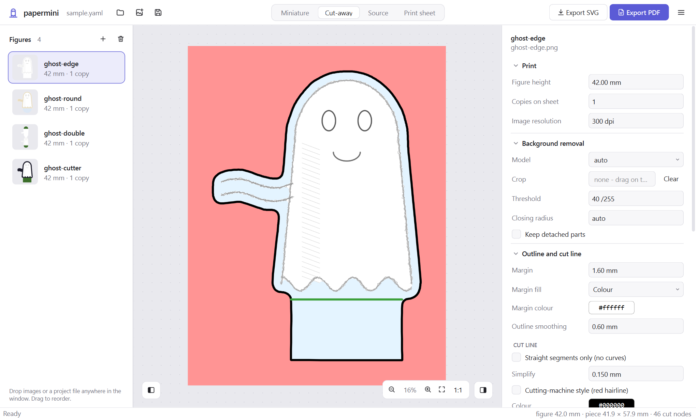

# papermini

Turn images (PNG/JPG) into **print-ready paper miniatures** for tabletop games like D&D (Dungeons & Dragons).

*Disclaimer: This tool is 100% vibecoded!*


# Features

- cuts the figure out of its background with locally running AI segmentation (or uses the
  image's own transparency),
- a smooth **vector cut line** with a margin, ready for scissors, Cricut,
  Silhouette or Inkscape,
- a **fold-over tab** so the figure stands up: square for a stand, or round to
  fold out into a base,
- **double-sided** minis with a mirrored, blank or text back,
- an **SVG per figure** in millimetres and an **A4/Letter PDF sheet** to print
  at 100%,
- a **desktop app** with live previews, and a command line for batches.

# Usage

You need Python 3.9 or newer. Clone the repository and run the setup script. It
creates a virtual environment in `~/.venvs/papermini` and installs papermini
with the desktop app, on Windows, macOS and Linux:

```bash
git clone https://github.com/MJLHThomassen/papermini.git
```

```bash
cd papermini
```

```bash
python scripts/setup_venv.py
```

Then start the app. On Windows:

```bash
~/.venvs/papermini/Scripts/papermini-gui
```

On macOS and Linux:

```bash
~/.venvs/papermini/bin/papermini-gui
```

1. **Add images.** Drop images onto the window, or use **+**. Each one becomes
   a figure in the list on the left.
2. **Adjust the settings** on the right: height, background removal, margin,
   tab shape and label, double-sided. The preview updates as you go.
3. **Check the cut.** The *Cut-away* view shows what is cut away (red) and the
   margin (blue). If the outline is wrong, try a lower threshold or drag a crop
   box in the *Source* view.
4. **Print.** The *Print sheet* view lays all figures out on pages. Click
   **Export PDF** and print it at 100% ("actual size"). Each page has a 50 mm
   bar to check the scale.

Save your work as a project (Ctrl+S). Projects are plain YAML files that the
command line can rebuild too.

| Cut-away view | Print sheet | Dark theme |
|---|---|---|
|  |  |  |

The first run downloads the background-removal model (about 176 MB). After
that, papermini works offline.

> [!IMPORTANT]
> The default model, [BRIA RMBG-1.4](https://huggingface.co/briaai/RMBG-1.4),
> is licensed for **non-commercial use only**. For commercial use, pick another
> model (`--model`, or *Model* in the app) or use images with transparency. See
> [background removal models](docs/reference.md#model-licence).

# Usage via CLI

The same venv has the `papermini` command (in `Scripts/` on Windows, `bin/` on
macOS and Linux). Activate the venv to use it from any folder.

Make one SVG per image:

```bash
papermini make lotje.png --height-mm 42 --label Lotje
```

Lay SVGs out on a printable PDF sheet:

```bash
papermini sheet "minis/*.svg" --copies 2 -o minis.pdf
```

Build a whole project (images, per-figure settings and the sheet) from a YAML
file, such as one saved by the app:

```bash
papermini batch examples/sample/sample.yaml
```

Run `papermini make --help` for all options. The
[reference](docs/reference.md) explains every option, the batch file format,
stands and bases, double-sided minis and tips for tricky drawings.

# Development

## Set up your environment

Install papermini in editable mode with the test dependencies:

```bash
python scripts/setup_venv.py --dev
```

The venv points at `src/` in your clone, so code changes take effect the next
time you start papermini. Re-run the setup only when `pyproject.toml` changes.

Run the app from a terminal, so its warnings and tracebacks show up there (on
Windows, `papermini-gui` has no console):

```bash
~/.venvs/papermini/Scripts/python -m papermini gui
```

Run the tests. They need no model download; the GUI tests run off-screen:

```bash
~/.venvs/papermini/Scripts/python -m pytest
```

On macOS and Linux, use `~/.venvs/papermini/bin/python`.

After changing the look of the app, regenerate the screenshots in
[docs/screenshots](docs/screenshots):

```bash
~/.venvs/papermini/Scripts/python scripts/screenshots.py
```

Contributors and coding agents: read [AGENTS.md](AGENTS.md) first.
