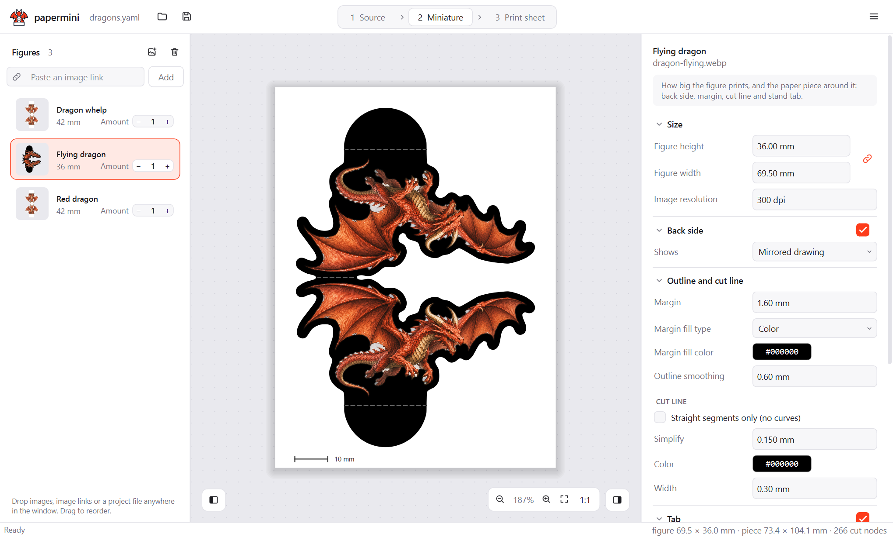
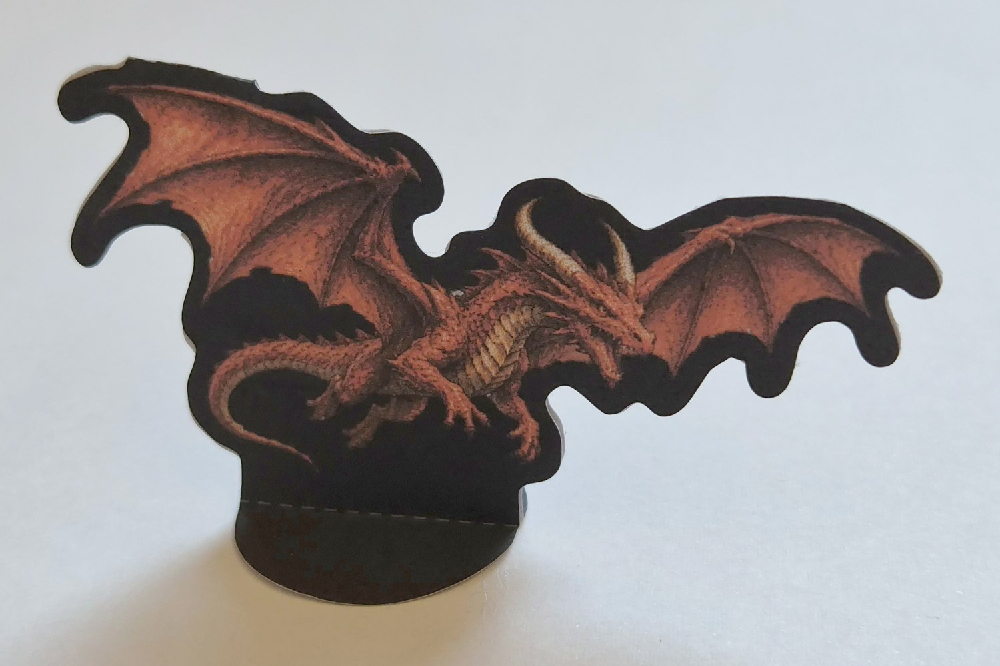
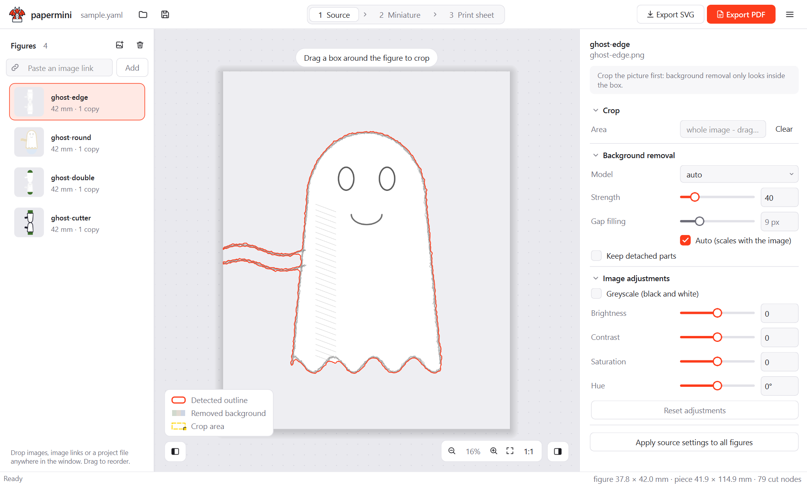
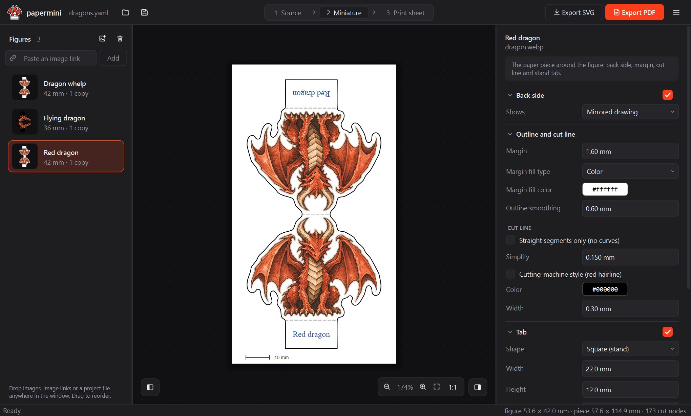
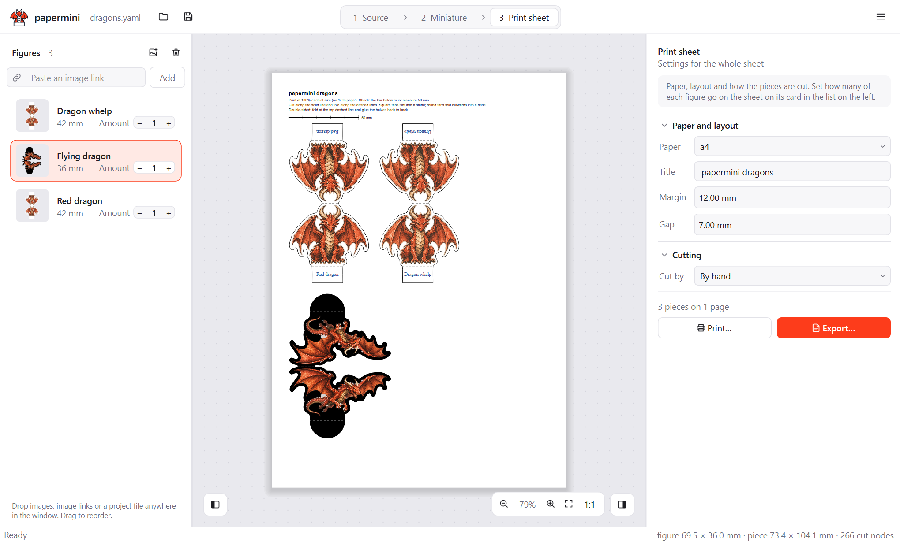

# papermini

Turn images (PNG/JPG) into **print-ready paper miniatures** for tabletop games like D&D (Dungeons & Dragons).

*Disclaimer: This tool is 100% vibecoded!*



<p align="center"><b>⬇️ Printed, cut out and folded, this is the mini made above ⬇️</b></p>

<p align="center">
  
</p>

**Contents**

- [Features](#features)
- [Quick start](#quick-start)
- [Usage via GUI](#usage-via-gui)
- [Usage via CLI](#usage-via-cli)
- [Development](#development)
  - [Run from source](#run-from-source)
  - [Set up your environment](#set-up-your-environment)
  - [Versions and releases](#versions-and-releases)
  - [Building the binaries locally](#building-the-binaries-locally)
- [Settings guide](docs/reference.md#settings-guide): every setting, with
  pictures (in the reference)

# Features

- **[Background removal](docs/reference.md#background-removal)**: AI models that run on
  your own computer, or the image's own transparency.
- **[Cropping](docs/reference.md#crop)**: drag a box to keep only the figure.
- **Cut line**: a smooth vector outline with a margin, for scissors or a knife.
- **[Cutting machines](docs/reference.md#cutting-by-machine)**: a sheet with
  alignment marks, plus a cut file with the cut lines and the same marks.
- **[Stand tab](docs/reference.md#stands-and-bases)**: square to slot into a
  stand, or round to fold out into a base.
- **[Double-sided](docs/reference.md#double-sided-minis)**: a mirrored, blank
  or text back, folded over the head.
- **[Color adjustments](docs/reference.md#color-adjustments)**: greyscale,
  brightness, contrast, saturation and hue.
- **Print sheets**: A4 or Letter PDF pages at real size, or an SVG per figure.
- **Any image**: PNG, JPG, WebP, BMP, TIFF, or a link to an image on the web.
- **[App](#usage-via-gui) and [command line](#usage-via-cli)**: live previews
  in the app, batches from the command line.

### [All features / settings →](docs/reference.md#settings-guide)


# Quick start

1. Download papermini from the
   [latest release](https://github.com/MJLHThomassen/papermini/releases/latest),
   unpack it and start it.
2. Make your first mini:
   1. Drop an image onto the window, for example
      [dragon.webp](examples/dragons/dragon.webp).
   2. In **1 Source**, drag a box around the figure. Its outline is drawn on
      the image.
   3. In **2 Miniature**, type the label for the tab, such as `Red dragon`.
   4. Still in **2 Miniature**, set the figure height under *Size*, such as
      42 mm. Set how many to print with the − and + on its card in the list.
   5. In **3 Print sheet**, click **Print…** and print at 100%. Cut along the
      solid line, fold along the dashed lines and glue the two halves back to
      back.

<details><summary>Does papermini not start the first time?</summary>

The downloads are not code-signed, so the first start can need one extra step:

- **macOS:** macOS blocks the first start with a message that offers only
  *Done* and *Move to Trash*. Click *Done*, then open **System Settings →
  Privacy & Security**, scroll down to *Security* and click **Open Anyway**
  next to papermini (the button shows up after you tried to open it). Confirm,
  and from then on papermini opens as usual.
- **Windows:** if SmartScreen warns, click *More info*, then *Run anyway*.
- **Linux:** Qt needs a few X11 libraries; on Debian and Ubuntu, run
  `sudo apt install libxcb-cursor0`.
</details>

# Usage via GUI

1. **Add images.** Drop images onto the window, or use the add-image button
   above the figure list. You can also drag a picture from your browser, paste
   one with Ctrl+V, or paste its link into the link bar. Each image becomes a
   figure in the list on the left; the − and + on its card set how many of it
   go on the sheet.
2. **Step 1, Source.** Drag a box around the figure to crop it, and pick the
   background removal model. The outline that was found is drawn on your
   image, and everything outside it is faded. If the outline is wrong, try a
   lower strength, a tighter crop or another model. A slow model can be
   cancelled. [All Source settings](docs/reference.md#step-1-source).
3. **Step 2, Miniature.** Set the size, back side, margin, cut line, tab and label.
   The back side, tab and label each have a checkbox in their header to turn
   them on or off; all three are on by default, so a mini has a front and a
   back, folded over the head. The preview updates as you go.
   [All Miniature settings](docs/reference.md#step-2-miniature), including
   the tab's [overlap](docs/reference.md#overlap-into-figure) and
   [fold](docs/reference.md#fold-above-lowest-point).
   **Export SVG…** at the bottom saves the piece as an SVG.
4. **Step 3, Print sheet.** Set the paper and how the pieces are cut (by hand,
   or by cutting machine), and see all figures laid out on pages. Click
   **Print…** to print them straight away at real size, or **Export…** to save
   a PDF (print it at 100%, "actual size") and, for a cutting machine, the cut
   file. Each page has a 50 mm bar to check the scale.
   [All Print sheet settings](docs/reference.md#step-3-print-sheet).

| Step 1, Source | Step 2, Miniature (dark theme) | Step 3, Print sheet |
|---|---|---|
|  |  |  |

The settings panel on the right shows the settings of the step you are on.
You can switch steps at any time. The
[settings guide](docs/reference.md#settings-guide) explains every setting,
with pictures of different values.

Save your work as a project (Ctrl+S). Projects are plain YAML files that the
command line can rebuild too.

> [!IMPORTANT]
> The default background-removal model,
> [BRIA RMBG-1.4](https://huggingface.co/briaai/RMBG-1.4), is licensed for
> **non-commercial use only**. For commercial use, pick a
> [BiRefNet](https://github.com/ZhengPeng7/BiRefNet) model
> ([MIT licence](https://github.com/ZhengPeng7/BiRefNet/blob/main/LICENSE)) or
> use images with transparency. See
> [background removal models](docs/reference.md#model-licence).

# Usage via CLI

The `papermini` command comes with the app: next to `papermini-gui` in the
Windows and Linux downloads, and at `papermini.app/Contents/MacOS/papermini` on
macOS. When running from source, it is in the venv (`Scripts/` on Windows,
`bin/` on macOS and Linux).

Make one SVG per image:

```bash
papermini make dragon.png --height-mm 42 --label "Red dragon"
```

Lay SVGs out on a printable PDF sheet:

```bash
papermini sheet "minis/*.svg" --copies 2 -o minis.pdf
```

Build a whole project (images, per-figure settings and the sheet) from a YAML
file, such as one saved by the app:

```bash
papermini batch examples/dragons/dragons.yaml
```

Run `papermini make --help` for all options. The
[reference](docs/reference.md) explains every option, the batch file format,
stands and bases, double-sided minis and tips for tricky drawings.

# Development

## Run from source

You need Python 3.10 or newer. Clone the repository:

```bash
git clone https://github.com/MJLHThomassen/papermini.git
```

```bash
cd papermini
```

The setup script creates a virtual environment in `~/.venvs/papermini` and
installs papermini with the desktop app:

```bash
python scripts/setup_venv.py
```

Then start `~/.venvs/papermini/Scripts/papermini-gui` (Windows) or
`~/.venvs/papermini/bin/papermini-gui` (macOS, Linux).

## Set up your environment

To work on papermini, install it in editable mode with the test dependencies:

```bash
python scripts/setup_venv.py --dev
```

The venv points at `src/` in your clone, so code changes take effect the next
time you start papermini. Re-run the setup only when `pyproject.toml` changes.

Run the app from a terminal, so its warnings and tracebacks show up there (on
Windows, `papermini-gui` has no console):

```bash
~/.venvs/papermini/Scripts/python -m papermini gui
```

Run the tests. They need no model download; the GUI tests run off-screen:

```bash
~/.venvs/papermini/Scripts/python -m pytest
```

On macOS and Linux, use `~/.venvs/papermini/bin/python`.

After changing the look of the app, regenerate the screenshots in
[docs/screenshots](docs/screenshots). They show the dragons in
[examples/dragons](examples/dragons) and need the rmbg-1.4, birefnet-lite and
birefnet models:

```bash
~/.venvs/papermini/Scripts/python scripts/screenshots.py
```

Contributors and coding agents: read [AGENTS.md](AGENTS.md) first.

## Versions and releases

papermini uses [semantic versioning](https://semver.org). The version comes
from git tags, so there is no version number to edit: tag `v1.2.3` builds
version 1.2.3, and commits after it report a development version such as
`1.2.4.dev3+g1a2b3c4` (`papermini --version`).

To release, tag a commit on `main` and push the tag:

```bash
git tag v1.2.0
```

```bash
git push origin v1.2.0
```

The [release workflow](.github/workflows/release.yml) then runs the tests,
builds the Windows, macOS and Linux downloads and publishes them as a GitHub
release with SHA-256 checksums. The release notes list every commit since the
previous version tag, grouped by Conventional Commit type, with the pull request
each came in with (`python scripts/release_notes.py v1.2.0` shows them before
you tag). A tag with a suffix, such as `v1.2.0-rc.1`, makes a pre-release. To try the builds without releasing, run
the workflow by hand from the *Actions* tab; the downloads appear as workflow
artifacts.

## Building the binaries locally

```bash
python scripts/setup_venv.py --dev --build
```

```bash
~/.venvs/papermini/Scripts/pyinstaller packaging/papermini.spec --noconfirm
```

The result is in `dist/`. PyInstaller builds for the system it runs on only.
