# papermini reference

The full details behind the [README](../README.md): every command-line option,
the desktop app in depth, and how the pipeline works.

- [Desktop app](#desktop-app)
- [Settings guide](#settings-guide)
- [Commands](#commands)
- [Background removal models](#model-licence)
- [Stands and bases](#stands-and-bases)
- [Double-sided minis](#double-sided-minis)
- [Numbered copies](#numbered-copies)
- [Cutting by machine](#cutting-by-machine)
- [Color adjustments](#color-adjustments)
- [Installing on Windows](#installing-on-windows)
- [Updates](#updates)
- [Logs and reporting a problem](#logs-and-reporting-a-problem)
- [Tips](#tips)
- [How it works](#how-it-works)
- [Caching and speed](#caching-and-speed)
- [Tests](#tests)

## Desktop app

- **Header.** Open and save on the left; the three steps of the workflow in
  the middle of the window (**1 Source**, **2 Miniature**, **3 Print sheet**);
  the ☰ menu on the right. The steps are in the order you usually work, but you
  can open any of them at any time. Export and print are in the step they
  belong to: **Export…** at the bottom of the Miniature settings (an SVG or a PNG of
  the figure), **Print…** and **Export…** at the bottom of the Print sheet settings.
  The ☰ menu has them too, and holds everything else: new project, **Open recent**,
  **Add folder…**, save as, **Export all…**, **View**
  (show or hide the side panels, zoom), **Preferences…**, **Check for updates…**,
  **Report a problem…**, **Open log folder** and about. Keyboard shortcuts work without
  opening the menu: Ctrl+O open, Ctrl+I add images, Ctrl+Shift+I add a folder, Ctrl+L add
  an image from a link,
  Ctrl+V paste images, Ctrl+S save, Ctrl+Shift+P print, Ctrl+E export the figure,
  Ctrl+Shift+E export all figures, Ctrl+P export the sheet, Ctrl+0 fit, Ctrl+1 actual size, Ctrl+B figure list, Ctrl+Alt+B settings,
  Ctrl+, preferences.
- **Start screen.** A new window shows how to begin: **Add images…**, **Open
  project…**, *or add from a link…* and *or add a folder…*. Under them,
  **Recent projects** lists the five projects opened or saved last, each with its
  folder; click one to open it.
- **Open recent** (☰ menu) lists the ten projects opened or saved last, newest
  first, each with its folder. Opening a project (from the menu, by dropping it or
  from the command line) or saving one puts it on top. A project whose file is gone
  is left out. **Clear list** empties it.
- **Images.** PNG, JPG, WebP, BMP and TIFF. Besides files, an image can come
  from the web: paste its link (URL) into the bar at the top of the figure list
  and press Enter; you can also drag a picture from a browser onto
  the window, or copy it (or its link) and press Ctrl+V. A link is downloaded
  once into `~/.cache/papermini/images/`; the project keeps the link itself, so
  it still works on another computer. A link must point at the image, not at
  the web page that shows it: right-click the picture and copy its address.
- **Side panels.** Drag the dividers to resize the figure list and the settings,
  or drag them shut. The buttons in the bottom corners of the canvas hide and
  show them (filled = shown) and stay put while a panel is hidden.
- **Figures** (left). Each figure is a card with a thumbnail of the finished
  piece, its height and its **Amount**: how many of it go on the print sheet.
  Click − or + to change the amount, or click the number and type one; 0 leaves
  the figure off the sheet. In a narrow list the height gives way first, then
  the word *Amount*. Add images with the add-image button
  above the list, add a folder of images with the folder button next to it, add one
  from the web by pasting its link into the link bar under it, or drop files, folders
  or a project anywhere in the window. Drag to reorder; **Delete**
  removes the selected one. A new figure starts with the settings of the one
  that is selected.
- **Settings** (right). The options of the step you are on, in sections you
  can fold open and closed (the app remembers which). The
  [settings guide](#settings-guide) explains each of them:
  - **Source:** *Crop*, then *Background removal* (model, strength, gap
    filling, detached parts), then *Image adjustments* (greyscale,
    brightness, contrast, saturation, hue, and *Reset adjustments*; see
    [Color adjustments](#color-adjustments)).
  - **Miniature:** at the top, the **Kind**: *Standing mini* or *Token* (see
    [Tokens](#tokens)). A standing mini has *Size* (figure height and width, image
    resolution), then *Back side*, *Image outline*, *Cut line* and *Tab*, with
    *Label* as an indented sub-group at the end of *Tab* (the label is
    printed on the tab). *Back side*, *Tab* and *Label* each have a checkbox
    at the right of their header that turns the whole group on or off
    (*Print a back side*, *Print a tab*, *Print a label*); all three are on
    by default. A group that is off shows only its header and cannot be
    opened; turning the tab off also hides *Label*. A token has *Size* (its
    diameter), *Token*, *Token text*, *Image outline* and *Cut line*; its *Token
    text*, *Image outline* and *Cut line* have a checkbox in their header too, all
    off by default. **Export…** at the bottom saves this figure as an SVG (the piece
    with its cut line, to print or cut) or a PNG (a picture of the piece, for a
    virtual tabletop): pick the file type in the save dialog. A figure that shows
    numbers gets one file per copy, each with its number. **Export all…** (☰ menu)
    asks for SVG, PNG or both, and saves every figure.
  - **Print sheet:** instead of a figure's settings, the sheet's own: *Paper
    and layout* (paper, title, margin, gap) and *Cutting* (by hand, or by
    [cutting machine](#cutting-by-machine), with its bleed, marks and fold
    lines), then how many pieces and pages there are, **Print…** and
    **Export…**.

  The settings side cannot be made narrower than its widest step needs, so
  no field or checkbox is ever cut off; drag it shut to hide it instead.

  The preview updates about a second after each change, and fast series of
  changes (holding an arrow key) only build the final value. The model only
  runs once per image and crop. Changing an *Amount* only updates the sheet.
  Number fields step with the arrow keys, or the mouse wheel once you click
  into them, so scrolling the panel never edits values. Decimals use a point
  (`1.6`) whatever your system's language; a typed comma becomes a point.
  The *Apply … to all figures* button copies the settings of the step you are
  on to every other figure, except the crop, mask file, label and amount.
- **1 Source.** The original image with the outline that background removal
  found, before any margin or tab (those belong to the miniature). Everything
  outside the outline is faded, so you can spot a clipped sword tip or a
  detached part that was dropped. A legend in the bottom-left corner explains
  the outline, the faded background and the crop box. Crop first: drag a box on the image and the
  model only looks inside it, which helps a lot with busy backgrounds.
  Afterwards:
  - drag its **handles** (corners and edge midpoints, or anywhere along an
    edge) to resize it;
  - drag **inside** it to move it;
  - drag **outside** it to draw a new box;
  - press **Delete** or **Clear crop** (next to the zoom controls) to clear it,
    or **Esc** to cancel a drag;
  - press **Ctrl+Z** to undo a crop change (one at a time, also for another
    figure, which is then selected).

  Until there is a crop box, a hint above the image says to drag one, and dashed
  guide lines through the mouse show where it would start. Over a box, the part
  a drag would grab lights up: a handle, an edge, or the whole box. A click, or
  a press that barely moves, changes nothing, so it never starts the model by
  accident.

  The mouse wheel zooms and the middle mouse button pans.

  While a model runs, the image is dimmed and a card shows the model and how
  long it has been running, with **Cancel**. Cancel stops the model right
  away, also while it is still loading (the first run of a model loads it,
  which can take longer than the run itself). The figure then waits until you
  press **Run again** or change the image, crop or model; other settings, such
  as the margin, do not start the model again. A new crop or model also stops
  a run that is no longer needed, so a misclick on a slow model (BiRefNet)
  costs nothing. The app runs one model at a time: a figure that waits for
  another figure's model (an image you just added, say) shows a card with that
  figure's name, and its Cancel stops that run so the selected figure goes
  next. New images take the settings of the selected figure, model included.
- **2 Miniature.** The piece as it will print, with a 10 mm scale bar. The
  zoom controls at the bottom right zoom, fit (Ctrl+0), or show the piece at
  real size (*1:1*, Ctrl+1), depending on the DPI your screen reports.
- **3 Print sheet.** A live preview of the sheet as it prints, with the
  sheet's settings beside it. **Print…** (or
  Ctrl+Shift+P) prints the sheet straight away, without saving a PDF first.
  It always prints at real size, from the corner of the paper, on the sheet's
  paper (A4 or Letter); the app warns if the printer is set to another paper
  size. With several pages you can pick which to print.
- **Exporting.** **Export…** (Ctrl+P) opens a small dialog: the folder, the
  name (the sheet's title to start with) and what to save, each with the exact
  file names: the sheet to print (PDF) and, cut by machine, the cut file (one
  SVG per page). It remembers what you ticked, so after printing from the app,
  saving only the cut file is one click; it asks before replacing files.
  Anything that still needs building is built in the background first; the
  window stays responsive and you can cancel.
- **Model downloads.** The first time a figure needs a model that is not on
  this computer yet, the app asks first: it shows the model, its download size,
  where it comes from, where it will be kept and its licence. *Download* shows
  the progress and can be cancelled; *Not now* leaves the figure with a note,
  and the app does not ask again until you pick another model. For rmbg-1.4,
  which is for non-commercial use only, you first tick *I will only use BRIA
  RMBG-1.4 non-commercially*; *Download* stays disabled until you do (also
  on the *Models and cache* page). See
  [Background removal models](#model-licence).
- **Preferences…** (☰ menu, Ctrl+,) holds the app's settings, on pages. Changes
  take effect at once; the window can be resized.
  - **Creature sizes:** the size table presets. See
    [Creature sizes](#creature-sizes).
  - **Images:** **Also add the images in subfolders** (on by default): whether
    adding a folder also adds the images in its subfolders (see
    [Adding a folder](#adding-a-folder)); and the **PNG size** of exported PNGs:
    *For a virtual tabletop*, in pixels per grid square (256 by default, so a Medium
    figure covers one square of a 256-pixel grid and a Large one two), or *At the
    size it prints*, in dpi (300 by default). It is a preference, not saved in the
    project.
  - **Appearance:** the theme: follow the system, light or dark.
  - **Updates:** **Update automatically** turns the daily check and background
    download on or off. See [Updates](#updates).
  - **Logging:** **Detailed log**, and *Open log folder*. See
    [Logs and reporting a problem](#logs-and-reporting-a-problem).
  - **Models and cache:** what papermini keeps on this computer, in the cache folder
    (*Open folder*). *Clear cache…* deletes all of it, downloaded models included,
    after asking. Below that:
    - every built-in model with its licence, whether it is downloaded, its size and
      file name: *Download* or *Download again* (to replace a damaged file), and
      *Delete* to free disk space;
    - the other cached files, with how many there are and their size: the
      **masks** (the background removal of each image) and the **images from
      links**. *Clear* deletes them; papermini makes or downloads them again when
      it needs them. Images that open figures use are kept.
- **Check for updates…** and **About papermini** (☰ menu) open the About window,
  which shows the version and checks for a newer one. See [Updates](#updates).
- **Report a problem…** (☰ menu) opens a new bug report on GitHub with your
  papermini version and system filled in, and the log folder to attach the log
  from. See [Logs and reporting a problem](#logs-and-reporting-a-problem).

Projects are saved as [project files](#project-files) (YAML), which
`papermini build` builds on the command line, so anything set up in the app can
be rebuilt from there.

### Adding a folder

**Add folder…** (☰ menu, Ctrl+Shift+I), the folder button above the figure list,
*or add a folder…* on the start screen, or dropping a folder on the window adds
every image in it as a figure:

- **Order:** the folder's own images first, then each subfolder's, in natural order
  (*goblin 2* before *goblin 10*).
- **Subfolders** are included unless you turn off **Also add the images in
  subfolders** in **Preferences… → Images**. Hidden files and folders (a name
  starting with a dot) are skipped, and so are files that are not images.
- **Names:** a figure is named after its file, as usual. When files in different
  subfolders share a name, the subfolder goes in front: `goblins/leader.png` and
  `orcs/leader.png` become *goblins-leader* and *orcs-leader*. The label on the tab
  stays the file's name.
- **Images already in the project:** papermini asks whether to add them again.
- The status bar says how many images were added and how many other files were
  skipped. A folder without images papermini can read says so.

The project keeps each image, never the folder: adding new images to the folder
later does not add them to the project.

## Settings guide

Every setting in the app, in the order of the settings panel. Each one shows:

- its name, as in the app;
- its command-line flag (for `papermini add` and `papermini build`), or its
  project file key when it has no flag, and its default value in brackets, as
  the command-line help gives it;
- what it does, in one line;
- more detail or an example.

The pictures show the same dragon with different values.

### Step 1, Source

#### Crop

##### Area
`--crop x0,y0,x1,y1` [the whole image]\
The part of the image that background removal looks at.

Drag a box on the image, and anything outside it is left out. That helps a lot
with a busy background, or with a figure that shares its picture with
something else. *Clear* goes back to the whole image. On the command line the
box is given as fractions (0–1) or pixels. On this stat block, a box around
the dragon leaves out the text and the corner ornament:

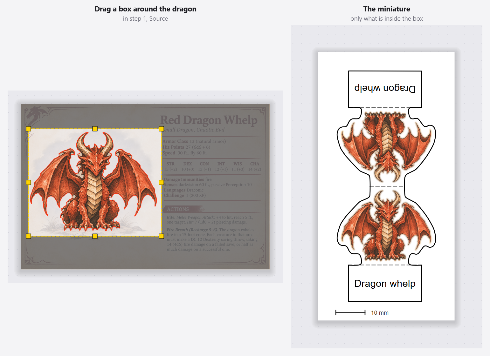

#### Background removal

##### Model
`--model` [auto]\
How the figure is cut out of its background.

*Auto* uses the image's own transparency when it has some, and rmbg-1.4
otherwise; a box under it says *Chosen method:* and which one it used for the
selected figure. While rmbg-1.4 is the model in use (picked, or chosen by
*Auto*), a red box under it says it is for non-commercial use only. *Mask image
file* uses a mask you painted yourself (see *Mask image
file*). The first time a model is needed, the app asks before downloading it;
after that, papermini works offline. **Preferences… → Models and cache** in the ☰ menu
shows which models are downloaded, and where.

| Model | Download | Loading | Per image | Licence |
|---|---|---|---|---|
| rmbg-1.4 (default) | 176 MB | 1.1 s | 1.5 s | non-commercial use only |
| birefnet-lite | 214 MB | 10.4 s | 10.6 s | MIT |
| birefnet | 928 MB | 14.1 s | 21.0 s | MIT |

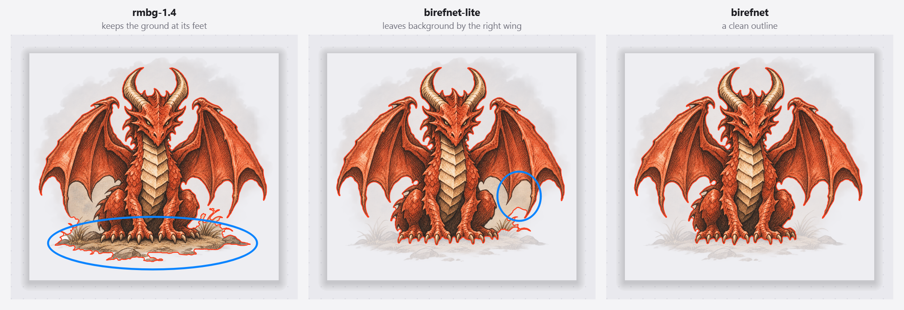

On this dragon, rmbg-1.4 is quick but keeps the ground at its feet,
birefnet-lite leaves a patch of background by the right wing, and birefnet
gives a clean outline. The circles mark what a model kept that birefnet
removed.

The times are for this image (1312 × 1199 pixels) on an Intel Core i7-4770K
from 2013, without the cache. A model loads once per session; the time per
image is the median of five runs. Results are cached, so an image is never
processed twice with the same crop and model. See
[Background removal models](#model-licence) for the licences and the other
model choices.

##### Mask image file
`--mask` [none]\
A black-and-white image that marks the figure, instead of a model.

Shown when *Model* is *Mask image file*. White is the figure and black the
background; the mask is stretched to the size of the picture. Use it when no
model gets a figure right, for example a faint sketch.

##### Strength
`--strength` [40]\
How sure the model must be that a pixel belongs to the figure (0–254).

Go lower when faint pencil lines or a thin sword get lost; go higher when bits
of background stay.

##### Gap filling
`--fill-gaps` [scales with the image, 9 px at 1400 px]\
Fills gaps and notches in the outline up to this many pixels.

For example the gap between a leg and a cloak, so the cut line does not dive
into it. *Auto* scales with the image: 9 px for a 1400 px image. 0 turns it
off.

##### Keep detached parts
`--keep-all` [off]\
Keeps every separate part of the figure, not only the largest.

Normally a speck or some text next to the figure is dropped. Turn this on for
a figure with a separate part, such as a floating staff or a spell effect:
every part is kept and joined to the figure with a 2.5 mm bridge.

##### Min. part area
`--min-area` [1000 px]\
With *Keep detached parts*: parts smaller than this are dropped as specks.

Raise it when dust or stray marks get joined to the figure; lower it when a
small part you want, such as a dagger, is dropped.

#### Image adjustments

These change the colors that are printed, never the outline, so they never
run the model again. **Reset adjustments** puts them all back, and a
double-click puts one slider back to 0. See
[Color adjustments](#color-adjustments).

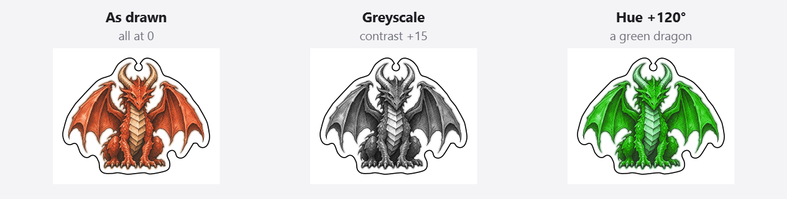

##### Greyscale (black and white)
`--greyscale` [off]\
Prints the figure in black and white.

Saves color ink, or gives a set of minis one look. Combine it with
*Contrast* for punchier lines.

##### Brightness
`--brightness` [0]\
Makes the picture lighter or darker (−100 to 100).

White paper stays white when you lighten, and black lines stay black when you
darken.

##### Contrast
`--contrast` [0]\
Makes lights lighter and darks darker, or flatter (−100 to 100).

A little extra contrast (10 to 20) can help a dull scan or a printer that
prints too pale.

##### Saturation
`--saturation` [0]\
Makes the colors stronger or weaker (−100 to 100).

−100 is grey and 100 twice as colorful.

##### Hue
`--hue` [0°]\
Turns every color around the color wheel (−180° to 180°).

Positive values go from red to yellow to green: +120 turns the red dragon
green, as in the picture above.

### Step 2, Miniature

##### Kind
`--kind mini|token` [mini]\
A standing paper miniature, or a flat round token.

At the top of the step. A token has its own groups (*Token* and *Token text*) and
no back side or tab; see [Tokens](#tokens).

#### Size

##### Creature size
`--size tiny|small|medium|large|huge|gargantuan|custom` [medium]\
The D&D size of the creature: it fills in the figure height and the tab.

Picking a size fills in *Figure height*, the tab's *Width*, *Height* and
*Radius* (and a token's *Diameter*) from the project's size table, for example 48 mm
tall on a 50 mm base for *Large*. The values stay editable: changing one by hand makes the
figure *Custom*. A hint under it shows the size's squares and base, and which
table they come from; a warning shows when the figure is wider than its
squares. See [Creature sizes](#creature-sizes).

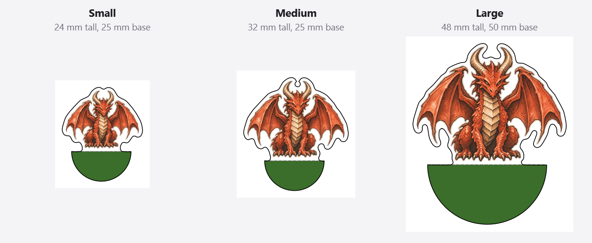

##### Figure height
`--height-mm` [32 mm, from the Medium size]\
The height of the drawing itself, without the margin and the tab.

With the link button beside the size on (the default), the figure keeps its
proportions: set the height and the width follows.

##### Figure width
`--width-mm` [set by the height]\
The width of the drawing itself, without the margin.

Linked, setting the width sets the height. With the link button off, the
figure is stretched to both the height and the width.

##### Diameter
`--token-diameter-mm` [25 mm, from the Medium size]\
A token's diameter, ring included.

Shown for a token, in place of the figure's height and width. The creature size
fills it in with its base (50 mm for *Large*); changing it by hand makes the token
*Custom*.

##### Image resolution
`--dpi` [300 dpi]\
The resolution of the printed picture.

300 suits most printers; lower values make smaller files.

#### Token

A token's picture and ring. Shown for a token.

##### Area
`--token-area x0,y0,x1,y1` [the whole figure, fitted]\
The square of the picture that fills the circle, as fractions of the picture.

Empty, the whole figure is fitted in the circle, with 8% of its width free on
each side (above the nameplate, when there is one). In the Miniature view, drag the
figure to move it and drag a corner of the box around it to make it bigger or
smaller; the figure moves with the mouse, and the token is built again when you
let go. *Clear* fits it again.

##### Background
`--token-fill color|image` [color]\
What fills the circle behind the figure: one color, or the original image.

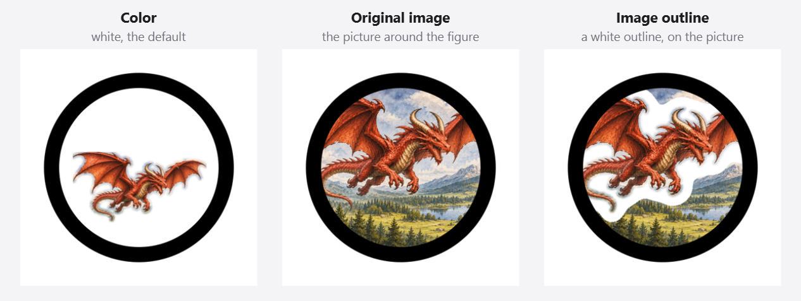

##### Background color
`--token-fill-color` [#ffffff (white)]\
The color behind the figure. Shown when *Background* is *Color*.

##### Ring width
`--token-border-mm` [2 mm]\
The width of the ring around the token; 0 for none.

With curved text the ring is at least as wide as the text needs (about 1.4 times
the text size); the field stops there and says so.

##### Ring color
`--token-border-color` [#000000 (black)]\
The color of the ring, the nameplate and the number badge.

#### Token text

Text on a token. The checkbox in the header (`--token-text`) turns it on or off;
off by default.

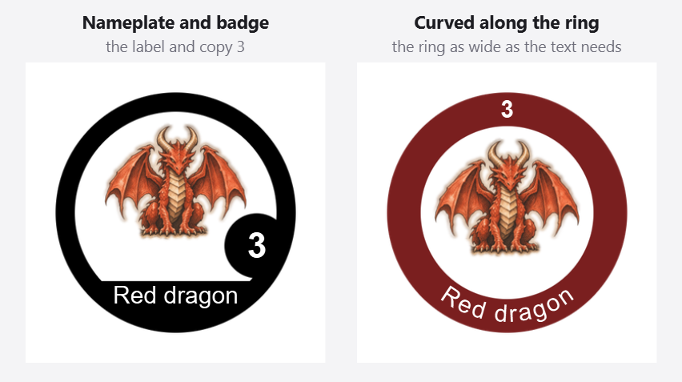

##### Shows
`--token-text none|label|number|label_number` [none]\
Nothing, the label, the copy's number, or both. See [Numbered copies](#numbered-copies).

##### Style
`--token-text-style nameplate|curved` [nameplate]\
Where the text goes.

*Nameplate and badge*: the label on a band across the bottom of the circle, the
number in a round badge on the ring. *Curved along the ring*: the label along the
bottom of the ring, the number at its top.

##### Size
`--token-text-mm` [2.5 mm]\
The size of the token's text.

It decides how much of the token the text covers: the nameplate is a little taller
than the text, and curved text needs a ring about 1.4 times as wide. A label too
long for the nameplate shrinks to fit.

##### Label
`--label` [the file name]\
The label on the token, the same as a standing mini's.

##### Color
`--token-text-color` [#ffffff (white)]\
The color of the token's text.

#### Back side

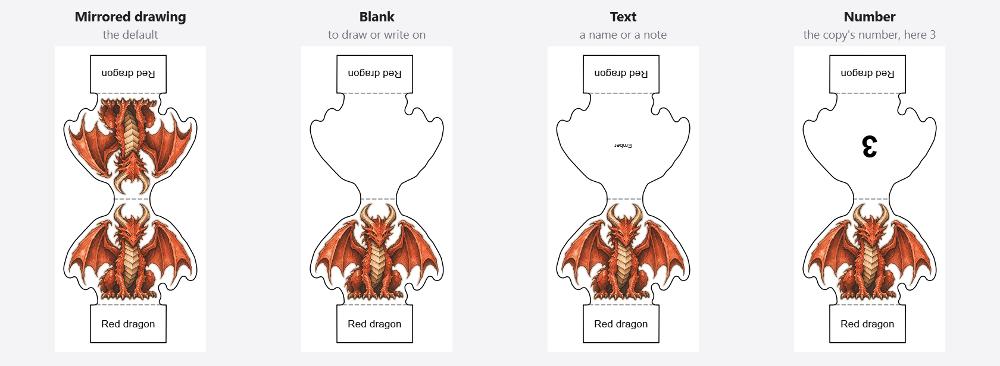

##### Print a back side
`--double-sided` / `--no-double-sided` [on]\
Prints the piece twice, joined at a fold above the head.

Fold it over and glue the halves back to back, so the figure looks right from
both sides. Off prints only the front. See
[Double-sided minis](#double-sided-minis).

##### Shows
`--back mirror|blank|text|number|text_number` [mirror]\
What is on the back half.

*Mirrored drawing* is the figure seen from behind. *Blank* is plain paper in
*Color*, for example to draw on. *Text* is plain paper with *Text* on it.
*Number* is plain paper with the copy's number on it, as large as fits, so
you can tell the goblins apart across the table. *Text and number* puts the
number above the text. See [Numbered copies](#numbered-copies). The cut line
is mirrored either way, so the halves always line up.

##### Color
`--back-color` [#ffffff (white)]\
The color of a back that is not the mirrored drawing.

Shown when *Shows* is not *Mirrored drawing*. The back's tab keeps the tab's
fill color.

##### Text
`--back-text` [the label]\
The text on a text back.

Shown when *Shows* is *Text* or *Text and number*. It is centred on the body
and sized as large as fits; a long text wraps. On the sheet it is upside down,
and it reads the right way up once the piece is folded.

##### Text color
`--back-text-color` [#2f5597 (blue)]\
The color of the text and the number on the back.

Shown when *Shows* has text or a number.

#### Image outline

The paper around the drawing: a standing mini always has it, a token only with the
checkbox in the header (`--token-outline`, off by default).

##### Margin
`--margin-mm` [1.6 mm]\
The distance between the drawing and the cut line.

A wider margin is easier to cut with scissors and keeps thin points, such as
claws and horn tips, stronger.

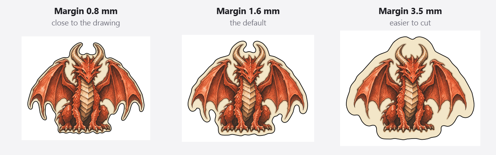

##### Margin fill type
`--margin-fill color|image` [color]\
What fills the margin: one color, or the original image.

*Original image* shows the picture around the figure in the margin, as it is
in the image.

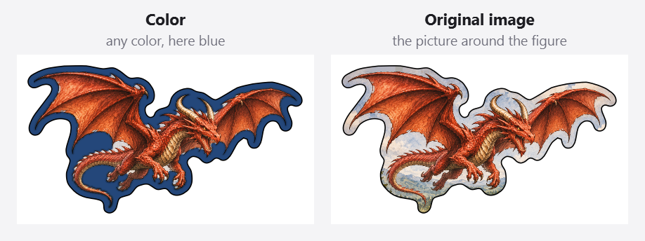

##### Margin fill color
`--margin-color` [#ffffff (white)]\
The color of the margin.

Shown when *Margin fill type* is *Color*. A dark margin hides a cut that is a
little off, as on the printed dragon at the top of the README.

##### Outline smoothing
`--smooth-mm` [0.6 mm]\
How much the outline is rounded.

More smoothing gives a calmer line with fewer bends to cut, but it also pulls
the line closer to thin tips, which then lose their margin.

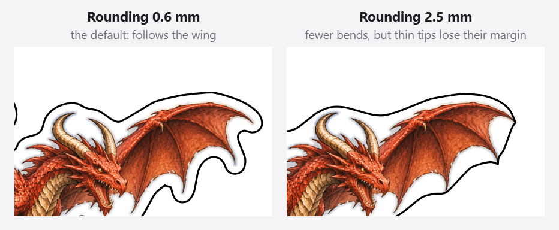

#### Cut line

The line to cut along. A standing mini always prints it (when cut by hand); a token
only with the checkbox in the header (`--token-cut-line`, off by default), since its
ring's edge shows where to cut. A token's cut line lies just outside the ring.

##### Straight segments only (no curves)
`--no-smooth` [off]\
Makes the cut line from straight lines instead of curves.

By default the SVG cut line uses smooth Bézier curves. Straight segments give
more points, for a program that handles only those.

##### Simplify
`--simplify-mm` [0.15 mm]\
How far the cut line may stray from the outline to use fewer points.

Higher values give fewer points and less detail; lower values follow the
outline more closely.

##### Color
`--cut-color` [#000000 (black)]\
The color of the printed cut line.

For cutting by hand. A sheet cut by machine prints no cut lines; its cut file
has them (see [Cut by](#cut-by) in the Print sheet step).

##### Width
`--cut-width-mm` [0.3 mm]\
The width of the printed cut line.

For cutting by hand: a thicker line is easier to follow with scissors.

#### Tab

The tab is the strip under the figure that folds back, so the figure stands
up. It folds at the dashed line. See [Stands and bases](#stands-and-bases).

##### Print a tab
`--no-tab` [off (the tab is printed)]\
Adds a tab under the figure.

Turn it off for a figure that goes into a slotted or magnetic base.

##### Shape
`--tab-shape square|round` [square]\
A square tab for a stand, or a round one that folds out into a base.

*Square* slots into a stand or is glued onto a base. *Round* is a half disc
that folds outwards, so the figure stands on it. On a double-sided mini the
two half discs fold out to opposite sides and make a full circle.

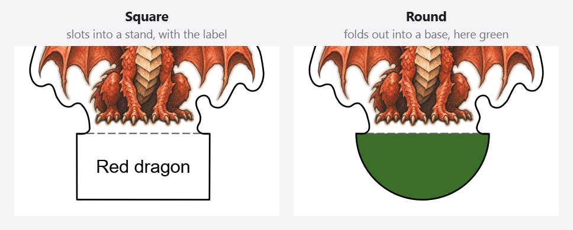

##### Width
`--tab-width-mm` [25 mm, from the Medium size]\
The width of a square tab.

Match it to the slot of your stand. The creature size makes it as wide as the
size's round base.

##### Radius
`--tab-radius-mm` [12.5 mm, from the Medium size]\
The radius of a round tab.

Shown when *Shape* is *Round*. 12.5 mm makes a 25 mm (one-inch) base; 25 mm
makes a 50 mm base for a large creature. The creature size sets it to half its
round base.

##### Height
`--tab-height-mm` [12.5 mm, from the Medium size]\
How far a square tab reaches below the fold.

A taller tab holds better in a deep slot or gives more room to glue.

##### Overlap into figure
`--tab-overlap-mm` [0 mm]\
How far the tab reaches up past the fold, into the figure.

Without overlap, the tab is joined to the figure only where the figure itself
reaches the fold. That is fine for two feet planted wide, but when only the
tip of a tail or a single claw reaches down, that tiny strip is all that holds
the tab, and it tears when you fold it. An overlap adds paper beside it, up to
the figure, so the tab is held along its whole width. The app warns when only
a narrow strip holds the tab. Where the figure's bottom is already wider than
the tab, the overlap adds nothing, and the app says so.

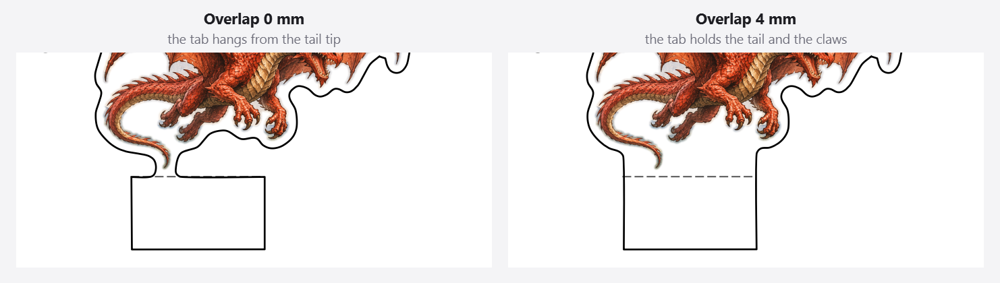

##### Fold above lowest point
`--fold-mm` [0 mm]\
Where the fold line is, measured up from the lowest point of the outline.

At 0 the fold is at the bottom of the margin, so the figure stands a margin's
height above the table. Set it to the margin (1.6 mm by default) to put the
fold right under the feet, so the figure stands on them. Everything below the
fold folds back with the tab and takes the tab's fill color; set it higher
and the feet fold back too. Leave it at 0 for a flying figure that has nothing
to stand on.

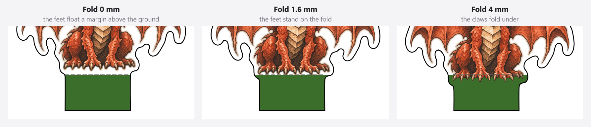

##### Fill color
`--tab-color` [#ffffff (white)]\
The color of everything below the fold, behind the label.

For example grass green or stone grey for a plain base, as on the round tab
above. It does not depend on the margin color.

#### Label

The label is text on the tab, in a sub-group at the end of *Tab*.

##### Print a label
`--label ""` [on]\
Prints a label on the tab.

Turn it off for a plain tab in its fill color. On the command line an empty
`--label ""` turns it off.

##### Text
`--label` [the file name]\
The text on the tab.

On a double-sided mini it is printed on both tabs. It is also the back text
when *Text* under *Back side* is empty.

##### Size
`--label-size-mm` [3.4 mm]\
The largest size of the label.

A long label shrinks to fit the tab.

##### Color
`--label-color` [#2f5597 (blue)]\
The color of the label.

Pick one that shows on the tab's fill color: a dark label on a dark tab
disappears.

#### Number

The copy's number on the tabs, in a sub-group at the end of *Tab*. Each copy
on the sheet gets its own number: 1, 2, 3 and so on. The preview shows `#`
where the number goes. See [Numbered copies](#numbered-copies).

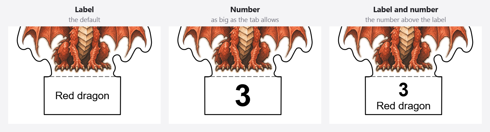

##### Front tab
`--tab-front label|number|label_number` [label]\
What the front tab shows.

*Label* is the label alone. *Number* is the copy's number, as large as the tab
allows. *Label and number* puts the number above the label, at least as large
as the label. The number is bold and in the label's color.

##### Back tab
`--tab-back label|number|label_number` [label]\
What the back tab shows.

Shown on a double-sided mini. The choices are those of *Front tab*.

#### Text

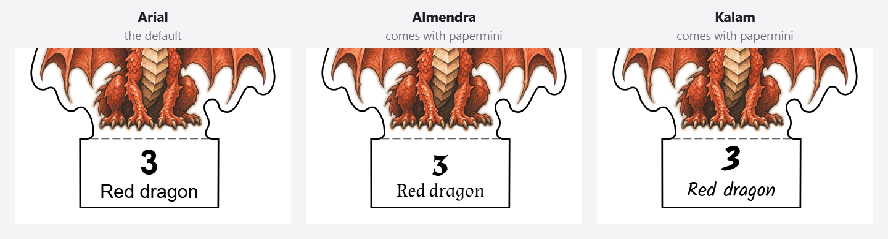

##### Font
`--font` [Times]\
The font of all the piece's text: the label, the numbers and the back text.

The list has Times first, then the fonts that come with papermini: Fira Sans,
Crimson Text, Almendra, MedievalSharp, Uncial Antiqua and Kalam. These work on
every computer. After them come the TrueType fonts installed on this computer;
each name is shown in its own font. The bundled fonts are free under the SIL Open
Font License; *About papermini* (☰ menu) names them and opens their folder,
where each font's licence is. Numbers use the font's bold; MedievalSharp
and Uncial Antiqua have no bold, so their numbers are regular.

The PDF sheet contains the font, so it prints the same anywhere. An SVG file
names the font but does not contain it, so other programs show it only where
it is installed.

A project keeps the font's name. On a computer without the font, the app
marks it *(not on this computer)* and the figure prints in Times; the command
line prints a note.

### Step 3, Print sheet

The settings panel holds the sheet's own settings on this step. How many of a
figure go on the sheet is set on its card in the figure list:

##### Amount
`--copies` [1]\
How many of this figure go on the print sheet.

On each figure's card: click − or +, or click the number and type one. 0
leaves the figure off the sheet. In a project file it is `copies`.

#### Paper and layout

##### Paper
`--paper a3|a4|a5|letter|legal|tabloid|custom` [a4]\
The paper size of the sheet.

The list shows each size: A3 (297 × 420 mm), A4 (210 × 297 mm), A5 (148 × 210
mm), Letter (8.5 × 11 in), Legal (8.5 × 14 in), Tabloid (11 × 17 in), and
*Custom* for a size of your own. **Print…** sets the printer to the sheet's
paper size and orientation, and the app warns when you pick another paper in
the print dialog.

A figure too big for the paper leaves the sheet empty. A red box under *Paper*
and a message on the sheet list the figures that do not fit, and say what to
do: pick bigger paper (or the other orientation, when that is enough), or make
the figure smaller in step 2. **Print…** and **Export…** ask first, and leave
those figures off the sheet. The command line stops with an error that names
the figure.

##### Orientation
`--orientation portrait|landscape` [portrait]\
Whether the page is upright or on its side.

Shown for a named paper size. Landscape fits wide figures and longer rows. A
custom size is used as you type it, so it has no orientation: type it wider
than tall for a landscape page.

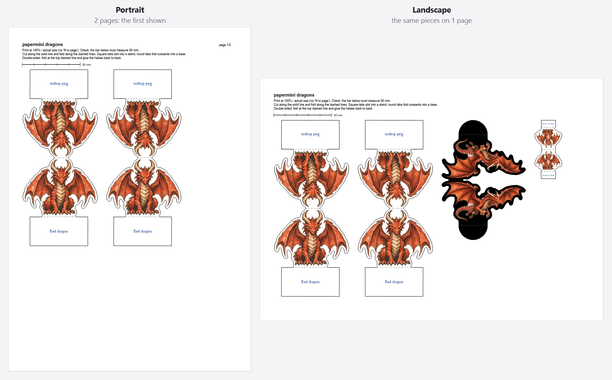

##### Width and Height
`--paper-width-mm`, `--paper-height-mm`\
The width and height of a custom paper size, as it prints (50 to 1200 mm).

Shown when *Paper* is *Custom*, for example for a print shop or a plotter.
They start at the size of the paper chosen before, so from A4 landscape Custom
starts at 297 × 210 mm. On the command line, giving them is enough: the paper
is then custom. In a project file it is `paper: custom` with `paper_width_mm`
and `paper_height_mm`.

##### Title
`--title` [Paper miniatures]\
The title at the top of each page.

It is printed above the instructions for cutting and folding.

##### Margin
`--sheet-margin-mm` [12 mm]\
The empty border around each page.

Keep it at least as wide as the edge your printer cannot print on. Cut by
machine, the alignment marks sit in the corners, this far from the paper edges.

##### Gap
`--gap-mm` [7 mm]\
The space between the pieces on the sheet.

A wider gap leaves more room for scissors between the pieces.

#### Cutting

##### Cut by
`--cut hand|machine` [hand]\
How the pieces are cut: by hand, or with a cutting machine.

*By hand* prints the cut lines on the sheet, for scissors or a knife.
*Machine* prints the sheet without cut lines but with alignment marks, and
**Export…** can also save a cut file: an SVG with the cut lines and the same
marks, to load in your cutting machine's software. See
[Cutting by machine](#cutting-by-machine).

##### Bleed
`--bleed-mm` [1 mm]\
Prints the edge colors this far beyond the cut line.

Shown when *Cut by* is *Machine*. The margin, tab or back color goes on past
the cut line, so a machine cut that is slightly off never shows a white edge.
In a project file it goes under `sheet`.

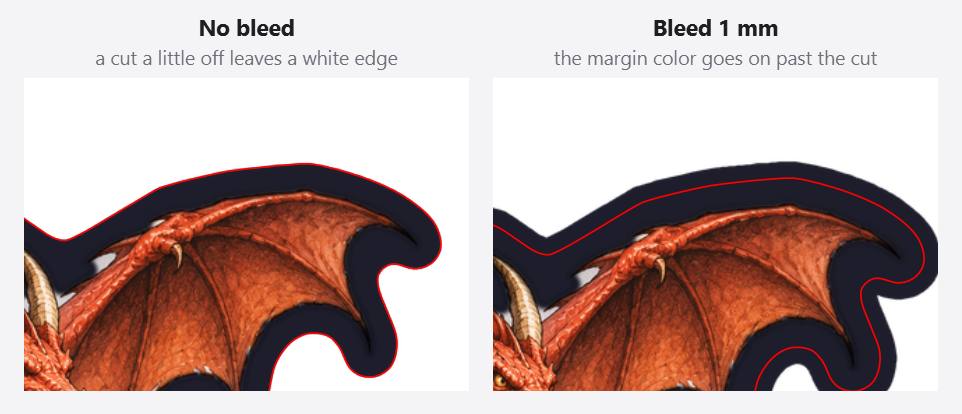

##### Marks
`--marks corners|silhouette|none` [corners]\
The alignment marks on the sheet and in the cut file.

Shown when *Cut by* is *Machine*. *Corners* is an L in each corner and a
small square top-left, so the page cannot be lined up the wrong way round.
*Silhouette* copies Silhouette Studio's *Type 1* marks: a filled square
top-left and an L top-right and bottom-left. See
[Cutting by machine](#cutting-by-machine) for the settings to match in
Silhouette Studio. *None* leaves the marks out: the cut file is then lined up
with the page itself.

##### Fold lines in cut file
`--cut-folds` [off]\
Also puts the fold lines in the cut file.

Shown when *Cut by* is *Machine*. The fold lines go in their own group, in
blue, so the cutting software can score or draw them, or leave them out. They
are always printed on the sheet.

##### Mat
`--mat 12x12|12x24` [any size, no note]\
The cutting mat you put the sheet on, to check that the paper fits it.

Shown when *Cut by* is *Machine*. A 12 × 12 in mat (305 × 305 mm) takes A4,
A5 and Letter; a 12 × 24 in mat (305 × 610 mm) also takes A3, Legal and
Tabloid. The paper may lie either way round on the mat. When the paper is
bigger than the mat, a red box says so (the command line prints a note); the
sheet is still made. *Any size* checks nothing. In a project file it is `mat`,
and it is kept when *Cut by* goes back to *By hand*.

## Commands

The command line works like the app. `papermini add` puts images in a project
file with their settings, and `papermini build` builds the project and writes
the files you ask for. `papermini build` also takes images directly, for a
piece without a project file.

### `papermini add PROJECT.yaml [IMAGE...] [options]`

Adds images to a project file, with the settings the [figure options](#figure-options)
give, and sets the project's sheet with the [sheet options](#sheet-options). The
file is made when it does not exist yet. Nothing is built: `papermini build`
does that.

- **Images** are image files, glob patterns such as `*.png`, links (an `http://`
  or `https://` URL to a PNG, JPG, WebP, BMP or TIFF; downloaded once and cached,
  and the project keeps the link) or folders.
- **A folder** adds every image in it and in its subfolders, in natural order
  (*goblin 2* before *goblin 10*), and papermini says how many it found.
  `--no-subfolders` takes only the folder's own images. Hidden files and folders
  and files that are not images are skipped. Files in different subfolders that
  share a name get the subfolder in front, as with
  [Add folder…](#adding-a-folder) in the app. The project keeps each image, not
  the folder.
- **The figure options** apply to the images of this `add`. `--grid-mm` sets the
  grid of the project's size table, so the creature sizes scale with it.
- **The sheet options** change the project's sheet. `add` without images only
  changes the sheet.

`add` saves the project the way the app does: comments in a hand-written project
file are not kept, and its `defaults` are written into each figure.

```bash
papermini add lair.yaml dragon.png --size large --label "Red dragon"
```

```bash
papermini add lair.yaml Monsters boss.png --strength 60
```

```bash
papermini add lair.yaml --paper letter --cut machine
```

#### Figure options

The settings of the figures, for `papermini add` and for images given to
`papermini build`. Without a flag, a figure gets the default, or for its size
the value its [creature size](#creature-sizes) fills in.

| option | default | meaning |
|---|---|---|
| `--size` | medium | D&D creature size (`tiny`, `small`, `medium`, `large`, `huge`, `gargantuan` or `custom`): fills in `--height-mm` and the tab sizes from the built-in size table. An explicit height or tab flag wins and makes the figure `custom`. Prints a warning when the figure is wider than its squares |
| `--grid-mm` | 25.4 | grid square for `--size`: the size table is calculated for this grid, bases and heights alike (Medium 32 × grid / 25.4 mm) |
| `--height-mm` | 32 (Medium) | height of the drawn figure, without margin and tab |
| `--width-mm` | set by the height | width of the drawn figure. Alone it sets the size by width (the proportions stay); with `--height-mm` the figure is stretched to both |
| `--margin-mm` | 1.6 | distance between the drawing and the cut line (filled as set by `--margin-fill`) |
| `--smooth-mm` | 0.6 | how much the outline is rounded |
| `--tab-shape` | square | `square` slots into a stand; `round` is a half disc that folds out into a base |
| `--tab-width-mm` / `--tab-height-mm` | 25 / 12.5 (Medium) | square tab size (height measured below the fold) |
| `--tab-radius-mm` | 12.5 (Medium) | round tab radius (12.5 makes a 25 mm base) |
| `--tab-color` | #ffffff | tab color (everything below the fold), behind the label; independent of the margin color |
| `--tab-overlap-mm` | 0 | how far the tab reaches up past the fold. It only adds paper where the figure's bottom is narrower than the tab (feet, a tail), to strengthen the joint; on a wide bottom it has no effect, and the app says so |
| `--fold-mm` | 0 | fold line distance above the silhouette's lowest point |
| `--no-tab` | off | no tab |
| `--double-sided` / `--no-double-sided` | on | front plus back, joined at a top fold, with a tab at both ends; `--no-double-sided` prints the front only |
| `--back` | mirror | double-sided back: `mirror` (the drawing seen from behind), `blank` (white paper), `text`, `number` (the copy's number) or `text_number` (the number above the text) |
| `--back-text` | the label | text for `--back text` or `text_number`; auto-sized and wrapped to fit the figure |
| `--back-color` | #ffffff | color of a back that is not `mirror` |
| `--back-text-color` | #2f5597 | color of the text and the number on the back |
| `--model` | auto | how the figure is separated from the background: `auto` (the image's transparency if it has any, else `rmbg-1.4`), `rmbg-1.4`, `birefnet`, `birefnet-lite`, `alpha` (the image's own transparency), `mask` (with `--mask`) or the path of an `.onnx` model; see [Model](#model) |
| `--mask` | none | your own mask image (white = figure, black = background) instead of a model |
| `--crop x0,y0,x1,y1` | the whole image | region the model looks at, as fractions (0–1) or pixels |
| `--strength` | 40 | background removal strength (0–254): how sure the model must be that a pixel is figure; go lower for faint pencil, higher for busy scenes |
| `--fill-gaps` | scales with the image, 9 px at 1400 px | fill gaps and notches in the outline up to this many px; 0 = off |
| `--keep-all` / `--min-area` | off / 1000 | keep detached parts (≥ min-area px) and bridge them to the figure |
| `--margin-fill` | color | `color` fills the margin with `--margin-color`; `image` shows the original picture there |
| `--margin-color` | #ffffff | color of the margin around the drawing |
| `--greyscale` | off | print in black and white |
| `--brightness` | 0 | −100 (towards black) to 100 (towards white); white paper stays white, black lines stay black |
| `--contrast` | 0 | −100 (flat grey) to 100 (hard) |
| `--saturation` | 0 | −100 (grey) to 100 (twice as colorful) |
| `--hue` | 0 | turn every color around the color wheel, −180 to 180 degrees (red → yellow → green for positive values) |
| `--label` | the file name | text on the tab; `--label ""` for none |
| `--tab-front` / `--tab-back` | label / label | what the front and back tab show: `label`, `number` (the copy's number) or `label_number` (the number above the label) |
| `--font` | Times | font of all the text: Times, a bundled font (Fira Sans, Crimson Text, Almendra, MedievalSharp, Uncial Antiqua, Kalam) or an installed one; a font that is not found prints in Times |
| `--copies` | 1 | how many of the figure go on the sheet; a figure with numbers writes one file per copy, each with its number (`goblin-1.svg`, `goblin-2.svg`, …) |
| `--dpi` | 300 | resolution of the embedded artwork |
| `--simplify-mm` | 0.15 | cut line simplification tolerance |
| `--no-smooth` | off | straight segments only (by default the cut line uses Bézier curves) |
| `--cut-color` / `--cut-width-mm` | #000000 / 0.3 | cut line style |
| `--label-color` / `--label-size-mm` | #2f5597 / 3.4 | color and largest size of the tab label; a long label shrinks to fit the tab |
| `--kind` | mini | `mini` (a standing miniature) or `token` (a flat round token; see [Tokens](#tokens)) |
| `--token-diameter-mm` | 25 (Medium) | a token's diameter, ring included; filled in from the creature size's base |
| `--token-area` | the whole figure, fitted | `x0,y0,x1,y1`: the square of the picture that fills the circle, as fractions |
| `--token-fill` / `--token-fill-color` | color / #ffffff | behind the figure: a `color`, or the original `image` |
| `--token-border-mm` / `--token-border-color` | 2 / #000000 | the ring; 0 for none |
| `--token-outline` | off | an image outline around the figure, made with `--margin-mm`, `--margin-fill` and `--margin-color` |
| `--token-cut-line` | off | print the cut line (by default the ring's edge shows where to cut) |
| `--token-text` | none | `none`, `label`, `number` or `label_number` on the token |
| `--token-text-style` | nameplate | `nameplate` (a band and a badge) or `curved` (along the ring) |
| `--token-text-mm` / `--token-text-color` | 2.5 / #ffffff | the size and color of the token's text |

#### Sheet options

The settings of the sheet. `papermini add` saves them in the project;
`papermini build` uses them for that build only, and with images it uses them
for the sheet of `--sheet`.

| option | default | meaning |
|---|---|---|
| `--paper` | a4 | paper size: `a3`, `a4`, `a5`, `letter`, `legal`, `tabloid` or `custom` (with `--paper-width-mm` and `--paper-height-mm`) |
| `--paper-width-mm` / `--paper-height-mm` | none / none | a custom paper's width and height, 50 to 1200 mm; giving them is enough, the paper is then custom |
| `--orientation` | portrait | `portrait` or `landscape`, for a named paper size |
| `--sheet-margin-mm` | 12 | page margin; cut by machine, the alignment marks sit in it |
| `--gap-mm` | 7 | gap between pieces |
| `--title` | Paper miniatures | the title printed at the top of each page |
| `--cut` | hand | `hand` prints the cut lines on the sheet; `machine` leaves them off, adds alignment marks and writes a cut file per page |
| `--bleed-mm` | 1 | cut by machine: print the edge colors this far beyond the cut line; every figure is built with it |
| `--marks` | corners | cut by machine: the alignment marks, `corners`, `silhouette` (Silhouette Studio's Type 1) or `none` |
| `--cut-folds` | off | cut by machine: also put the fold lines in the cut file |
| `--mat` | any size, no note | cut by machine: the cutting mat, `12x12` or `12x24` inches; a note when the paper is bigger |

### `papermini build PROJECT.yaml [options]`, `papermini build IMAGE... [options]`

Builds a project file, or images without one, and writes the outputs the flags
ask for:

- `--svg`: each figure as an SVG, the piece with its cut line;
- `--png`: each figure as a PNG, a picture of the piece, transparent around it
  (see [Tokens](#tokens) for the PNG size);
- `--sheet`: the sheet to print as a PDF, and cut by machine its cut files
  (`minis-cut.svg`, `minis-cut-2.svg` and so on, next to the PDF);
- `--preview`: a PNG preview of each page of the sheet, along with the sheet.

Without any of them, a project writes each figure as an SVG and the sheet, when
the project makes one; images write an SVG each.

Each page of the sheet has an instruction header and a 50 mm calibration bar.
Pieces are packed in rows, with a gap between them (`--gap-mm`) and a margin
around each page (`--sheet-margin-mm`), and extra pages are added as needed.

**A project** writes where it says: the figures in its `output` folder, the
sheet at its sheet's `output` (`minis/sheet.pdf` by default). `-o DIR` writes
them all in `DIR` instead. The [sheet options](#sheet-options) change the sheet
for this build only. A project holds its figures' settings, so the figure
options are refused: change them with `papermini add`, in the file or in the
app.

```bash
papermini build lair.yaml
```

```bash
papermini build lair.yaml --sheet --paper a3 --preview -o print
```

**Images** take the same images as `papermini add` (files, glob patterns, links
and folders) and the [figure options](#figure-options). Each piece is saved next
to its image, or in `-o DIR`, or at `-o NAME.svg` or `-o NAME.png` for a single
image; a link's piece is saved in the current folder. With `-o DIR`, a folder's
subfolders are made again inside `DIR` (`goblins/leader.png` →
`DIR/goblins/leader.svg`). The sheet is `minis.pdf`, in `-o DIR` or the current
folder.

```bash
papermini build dragon.png --size large --label "Red dragon"
```

```bash
papermini build boss.png --height-mm 56 --crop 0.08,0,0.92,0.62 --strength 60 --fill-gaps 7
```

```bash
papermini build Monsters --png -o tokens
```

```bash
papermini build "minis/*.png" --sheet --cut machine --marks silhouette -o print
```

| option | default | meaning |
|---|---|---|
| `--svg` | off | write each figure as an SVG |
| `--png` | off | write each figure as a PNG |
| `--sheet` | off | write the sheet (PDF) and, cut by machine, its cut files |
| `--preview` | off | also write a PNG preview of each sheet page, as the sheet's `preview: true` does |
| `--png-px` / `--png-dpi` | 256 / none | PNG size: pixels per grid square (the project's grid, or `--grid-mm`), or a resolution in dpi for the size it prints |
| `--output` | the project's folders; for images, next to each image | the folder to write everything in, or for a single image the piece's file; `-o` for short |
| `--no-subfolders` | off | a folder: only its own images, not those in its subfolders |
| `--debug` | off | write intermediate masks and a red overlay preview of each figure to `debug/` in its folder, as `debug: true` in the project does |
| `--no-cache` | off | make every mask again instead of reusing the cached ones (see [Caching and speed](#caching-and-speed)) |

### Project files

A project file (YAML) lists the images with their settings, and the sheet. The
app saves projects in this format, and `papermini add` writes it; you can also
write one by hand. See [examples/minis.yaml](../examples/minis.yaml):

```yaml
output: minis                 # folder for the SVGs (and debug output)

sheet:
  output: minis/sheet.pdf
  paper: a4                   # or letter
  copies: 1                   # default copies per figure
  preview: true               # also write sheet.png
  title: Dragon's lair

defaults:
  height_mm: 42
  strength: 40
  fill_gaps: 9

figures:
  # The image has transparency, so it needs no model.
  - image: dragons/dragon.webp
    label: Red dragon
    copies: 2

  # A busy landscape behind the figure.
  - image: dragons/dragon-flying.webp
    label: Flying dragon
    strength: 60
    fill_gaps: 7

  # A stat block: let the model look only at the figure's region.
  - image: dragons/statblock-with-dragon.webp
    label: Whelp
    height_mm: 34
    crop: [0.03, 0.15, 0.565, 0.8]
```

The `sheet` also takes `orientation`, `title`, `margin_mm`, `gap_mm`, a custom
paper size (`paper: custom` with `paper_width_mm` and `paper_height_mm`) and, for
a [cutting machine](#cutting-by-machine), `cut: machine` with `bleed_mm`,
`marks`, `cut_folds` and `mat`; every figure is then built with the bleed.

```yaml
sheet: {paper: a3, orientation: landscape, cut: machine, mat: 12x24}
```

Projects saved by papermini start with the papermini version that saved them and
the project format, such as `papermini: 1.0.0` and `format: 1`. A file without
them, such as a hand-written one, is read as format 1. A project in a newer format
does not open, and the error names the papermini that saved it, so you know which
version to update to. A project from a newer papermini of the same format opens,
unless it uses an option this papermini does not know yet.

A figure takes every [figure option](#figure-options) under its own name, with
underscores: for example `tab_front: number`, `back: text_number`,
`font: Almendra` and `kind: token`. A figure that shows numbers writes one SVG per copy
(`goblin-1.svg` to `goblin-4.svg` for `copies: 4`), each with its number.

An `image` can also be a link, such as `image: https://example.com/goblin.webp`.
It is downloaded once (later runs use the cached copy) and saved projects keep
the link.

An `image` cannot be a folder: list its images one by one. (In the desktop app,
**Add folder…** does that for you.)

The size is `height_mm`, `width_mm` or both. One of them keeps the figure's
proportions; both stretch it to that height and width. A figure that gives only
`width_mm` is sized by width, but `defaults` count too: with `height_mm` in
`defaults`, write `height_mm: null` in a figure to size it by width only.

A figure's `size` (`tiny` … `gargantuan`, or `custom`) fills in `height_mm`,
`tab_radius_mm`, `tab_width_mm` and `tab_height_mm` from the project's size
table, for the values the figure does not give itself; a figure whose values
differ from its size's is `custom`. Saved projects always write a figure's
`size` and those four values, and the project's table under `sizes`: the preset
it came from, the grid, Medium's height, and each size's height, round base and
stand tab. A project without `sizes` uses the built-in table; a figure without
`size` is Medium. See [Creature sizes](#creature-sizes).

```yaml
sizes:
  preset: Standard 1-inch
  grid_mm: 25.4
  medium_mm: 32.0
  tiny: {height_mm: 16.0, base_mm: 12.5, tab_width_mm: 12.5, tab_height_mm: 6.25}
  # ... small, medium, large, huge
  gargantuan: {height_mm: 80.0, base_mm: 100.0, tab_width_mm: 100.0, tab_height_mm: 50.0}
```

[examples/dragons/samples.yaml](../examples/dragons/samples.yaml) builds the
sample outputs in [examples/dragons/samples](../examples/dragons/samples), six
ways to print the same dragon: a default (double-sided) mini, a single-sided
mini on a round colored base, a mini with back text, a mini with a dark margin
and a green tab, two numbered copies in Kalam, and two numbered round tokens. Their sheet is
[samples-sheet.pdf](../examples/dragons/samples/samples-sheet.pdf).
[samples-machine.yaml](../examples/dragons/samples-machine.yaml) makes a sheet
cut by machine:
[machine-sheet.pdf](../examples/dragons/samples/machine-sheet.pdf) and its cut
file [machine-sheet-cut.svg](../examples/dragons/samples/machine-sheet-cut.svg).

```bash
papermini build examples/dragons/samples.yaml
```

```bash
papermini build examples/dragons/samples-machine.yaml
```

<a id="model-licence"></a>

## Background removal models

The default model, [BRIA RMBG-1.4](https://huggingface.co/briaai/RMBG-1.4), is
licensed for **non-commercial use only** (see its model card). papermini itself
is MIT-licensed, but that does not cover the model: **if you use RMBG-1.4, you
are responsible for not using it commercially**, for example to make minis you
sell. It is the default because it is fast and works well on most artwork, and
most people make minis for their own table.

- In the desktop app you accept this before RMBG-1.4 downloads (a tick box in the
  download dialog), its licence is marked on the *Models and cache* page of
  Preferences, and a box under
  *Model* says so while it is the model in use.
- The command line prints the same notice when it downloads RMBG-1.4.

For commercial use, pick one of the [BiRefNet](https://github.com/ZhengPeng7/BiRefNet)
models ([MIT licence](https://github.com/ZhengPeng7/BiRefNet/blob/main/LICENSE)), use
images with transparency (`alpha`), paint your own mask, or bring your own ONNX
model. Every model downloads once, without an account.

| `--model`              | what                                                        |
|------------------------|-------------------------------------------------------------|
| `auto` (default)       | the image's own transparency if it has any, else `rmbg-1.4` |
| `rmbg-1.4`             | BRIA RMBG-1.4 (176 MB download), run with onnxruntime       |
| `birefnet`             | BiRefNet general: sharper edges and fine detail, but a 928 MB download and about 14× slower than RMBG-1.4 on a CPU (about 20 seconds per image) |
| `birefnet-lite`        | BiRefNet general with a small backbone: 214 MB download, about 7× slower than RMBG-1.4 |
| `alpha`                | use the image's own transparency                            |
| `path/to/model.onnx`   | your own ONNX model with RMBG-1.4-style input (RGB, `x/255-0.5`) |

You can also skip segmentation and pass a mask you painted yourself:
`--mask hero_mask.png` (white = figure).

## Creature sizes

D&D sizes follow the grid: Medium takes one square, Large 2 × 2, Huge 3 × 3 and
Gargantuan 4 × 4. A figure's *Creature size* fills in its height and its tab from a
size table. The built-in table is for a 1-inch grid (25.4 mm) and a 32 mm
("heroic" scale) Medium figure:

| Size | Squares | Height | Round base | Stand tab (w × h) |
|---|---|---|---|---|
| Tiny | ½ | 16 mm | 12.5 mm | 12.5 × 6.25 mm |
| Small | 1 | 24 mm | 25 mm | 25 × 12.5 mm |
| Medium | 1 | 32 mm | 25 mm | 25 × 12.5 mm |
| Large | 2 | 48 mm | 50 mm | 50 × 25 mm |
| Huge | 3 | 64 mm | 75 mm | 75 × 37.5 mm |
| Gargantuan | 4 | 80 mm | 100 mm | 100 × 50 mm |

The height is the drawn figure (*Figure height*). The round base sets the round
tab (its radius is half the base); the stand tab is the square tab.

**Calculating a table.** From a grid square and Medium's height:

- heights: Medium × 0.5, 0.75, 1, 1.5, 2 and 2.5 (Tiny to Gargantuan);
- round base: squares × grid × 25/25.4, a little under the grid so bases fit
  side by side (Tiny half a square);
- stand tab: as wide as the base and half as deep.

**Width.** The width follows the height. A figure wider than its squares
(squares × grid) gets a warning: give it a width, or a bigger size.

**Presets.** In the desktop app, **Preferences… → Creature sizes** manages size
table presets:

- the list on the left shows the built-in preset (*Standard 1-inch*, read-only:
  *Copy* it to make your own) and your own, with *New*, *Copy*, *Rename* and
  *Delete*. Under each name it says which one the open project uses and which one
  is the default for new projects;
- the selected preset's table is on the right: the grid square (with inches),
  Medium's height, *Calculate* (fills in every row, replacing values you
  changed) and every row editable, for example to fit the stand tab to your
  3D-printed bases. Changes are saved at once;
- *Use in this project* gives the open project the selected table; *Make default
  for new projects* sets the one new projects start with;
- editing the preset the open project uses changes the project too. Other saved
  projects keep their own copy until you open them and pick the preset again;
- a project table that matches none of your presets (from another computer, or
  changed since) shows as *This project's table*, with *Save as preset*.

When the window closes, every figure with a size takes its values from the
project's table. The project file keeps a copy of the table, so a project
opens the same on any computer.

**Command line.** `papermini build` and `papermini add` use the project's
table, and for a new project or images the built-in table; `--grid-mm 30`
calculates it for a 30 mm grid instead, heights included (Medium 32 × 30/25.4
≈ 37.8 mm). `papermini add` saves that table in the project.

## Stands and bases

The tab under the figure comes in two shapes:

- **Square** (`--tab-shape square`, the default) is a straight tab to slot into
  a stand, such as a 3D-printed one, or to glue onto a base.
- **Round** (`--tab-shape round`) is a half disc that you fold outwards so the
  figure stands on it. On a double-sided mini, the front and back tabs fold out
  to opposite sides and together make a full round base. `--tab-radius-mm` sets
  its size; 12.5 (the default) gives a 25 mm, one-inch base.

Either shape has its own color, `--tab-color`. It is white by default,
independent of the margin color, and covers everything below the fold. The
label is printed on it; use `--label ""` for a plain tab, for example grass
green or stone grey.

```bash
papermini build dragon.png --tab-shape round --tab-radius-mm 12.5 --tab-color "#3b6e2a" --label ""
```

The margin around the drawing can be any color (`--margin-color "#f3e6c8"`)
instead of white, or show the original image (`--margin-fill image`).

## Double-sided minis

Minis are double-sided by default: the piece is printed twice, joined at a fold
above the head. Fold it over and glue the halves back to back, so the figure
looks right from both sides. The cut line is always mirrored, so the halves line
up. `--no-double-sided` (or unticking the checkbox in the *Back side* header,
at the top of the app's Miniature step) prints only the front. What shows on
the back is up to you:

- `--back mirror` (default) shows the drawing seen from behind.
- `--back blank` leaves the back plain, in `--back-color` (white by default),
  for example to write or draw on by hand.
- `--back text` shows a name or short note, centred on the body and sized as
  large as fits:

  ```bash
  papermini build dragon.png --back text --back-text "Red Dragon Whelp"
  ```

  Without `--back-text`, it uses the label. On the sheet the back text is upside
  down; it reads the right way up once the piece is folded.
- `--back number` shows the copy's number, as large as fits, and
  `--back text_number` the number above the text. See
  [Numbered copies](#numbered-copies).

## Numbered copies

Six goblins that look the same are easier to tell apart with a number on each
("the third goblin is down"). Each figure's copies are numbered 1, 2, 3 and so
on, and another figure starts again at 1. The number is printed only where you
choose. By default no number is printed, also when there are several copies.

- **On the tabs:** `--tab-front` and `--tab-back` (in the app, *Front tab* and
  *Back tab* under *Number*) show the label, the number, or both, with the
  number above the label.
- **On the back:** `--back number` or `--back text_number` (in the app, *Shows*
  under *Back side*).
- **On a token:** `--token-text number` or `label_number` (in the app, *Shows*
  under *Token text*), on a badge or along the ring.

Once a figure shows its number, it is printed on every copy, also on a single
copy ("1"). Numbers are bold, in the font and color of the label; on the back,
in the back text's color. A sheet cut by machine prints them too; the cut lines
stay the same.

```bash
papermini build goblin.png --tab-front label_number --back number --copies 6 -o minis
```

This writes `goblin-1.svg` to `goblin-6.svg`, one per copy, each with its number.
The sheet (`--sheet`, or a project's sheet in `papermini build` and in the app)
prints each figure's `copies` with the numbers 1 to `copies`.

## Tokens

A token is a flat round piece: the cut-out figure in a circle, with a ring, for the
table or a virtual tabletop (Foundry, Roll20, Owlbear Rodeo). Set **Kind** to
*Token* at the top of the Miniature step (`--kind token`, `kind: token` in a
project). Background removal and the Source step are the same as for a standing
mini; a figure is either a mini or a token, so add an image twice for both.

```bash
papermini build goblin.png --kind token --token-text number --copies 6 -o tokens
```

- **Size:** the creature size gives the diameter, its base: 25 mm for Medium, 50 mm
  for Large, 75 mm for Huge.
- **Framing:** the whole figure is fitted in the circle, with room around it. Drag
  it in the Miniature view to move it, or drag a corner of its box to make it
  bigger or smaller (`--token-area`, the square of the picture that fills the
  circle).
- **Look:** the background (a color or the original picture), the ring (width and
  color), an optional image outline around the figure, and text: the label and the
  copy's number, on a nameplate and badge or curved along the ring.
- **Print sheet:** tokens go on the same sheet as standing minis, each copy with its
  own number. By default no cut line is printed: cut along the ring's edge. With a
  cut line (`--token-cut-line`) it lies just outside the ring. Cut by machine, the
  cut file has the circles and the bleed carries the ring's color past the cut.
- **Virtual tabletop:** export a PNG (**Export…** in the app and pick PNG, or
  `papermini build --png`): the piece, transparent around it, 256 pixels per grid square by
  default (*PNG size* in **Preferences… → Images**, `--png-px`), so a Medium token
  covers one square and a Large one two. Set it to your tabletop's grid size, or
  use a dpi (`--png-dpi`) for the size it prints. Standing minis export as PNG too.

## Color adjustments

Greyscale, brightness, contrast, saturation and hue change the colors of what
is printed: the drawing, a margin filled with the image (`--margin-fill image`)
and the mirrored back. They never change what background removal sees, so the
outline stays where it is and moving a slider never runs the model again; even
with BiRefNet the preview follows at once. In the app they are in *Image
adjustments* in step 1, and the Source view shows the adjusted picture (a
smaller preview on large photos; the print always uses the full image). Their
sliders have 0 in the middle, marked with a short line: the colored fill runs
from there to the handle, a drag that comes close to 0 snaps to it (typed values
are kept as they are), and a double-click puts a slider back to 0.

```bash
papermini build goblin.png --greyscale --contrast 15   # black and white, a bit punchier
papermini build goblin.png --hue 120 --saturation 20   # a green goblin from a red one
```

In a project file they are `greyscale`, `brightness`, `contrast`, `saturation`
and `hue`; *Apply source settings to all figures* in the app copies them along
with the background removal settings.

## Tips

- **Tune with `--debug`.** `debug/<name>_overlay.png` shows red for what will be
  cut away and light blue for the white margin. It also writes the masks from
  each step (`0_raw` → `5_cut`).
- **Faint pencil.** Lower `--strength` (for example 25–40) and raise `--fill-gaps` if
  the silhouette has gaps.
- **Busy background.** Use `--crop` around the figure and try `--strength 60`. A
  flat edge from the crop at the bottom is fine, because it sits on the tab.
- **Props lost.** Floating props are dropped by default. `--keep-all` keeps them
  and adds a bridge.
- **Printing.** Print a PDF at 100% / "actual size", never "fit to page"
  (the app's **Print…** does this for you). Measure the 50 mm bar to check.
- **Cutting machines.** Set the sheet's *Cut by* to *Machine*: see
  [Cutting by machine](#cutting-by-machine).

## Cutting by machine

Set *Cut by* to *Machine* in the Print sheet settings (`cut: machine` in a
project file, `--cut machine` on the command line). Then:

- **The PDF** is for printing. It has the pieces with a bleed (the edge colors
  go on 1 mm past the cut line), the fold lines and the labels, but no cut
  lines. Alignment marks sit in the corners, *Margin* (12 mm) from the paper
  edges. Nothing else comes within 6 mm of them: a piece that would moves along
  its row, and the header starts beside the top-left mark, so a machine sheet
  holds about as many pieces as one cut by hand.
- **The cut file** is for the cutting machine's software: an SVG the size of
  the page, in millimetres, with the cut line of every piece exactly where it
  is on the page, and the same marks in the same places. A sheet of several
  pages gets one per page: `NAME-cut.svg`, `NAME-cut-2.svg` and so on. Its
  groups are `registration` (the marks), `cut` (red hairlines) and, with *Fold
  lines in cut file*, `fold` (blue).

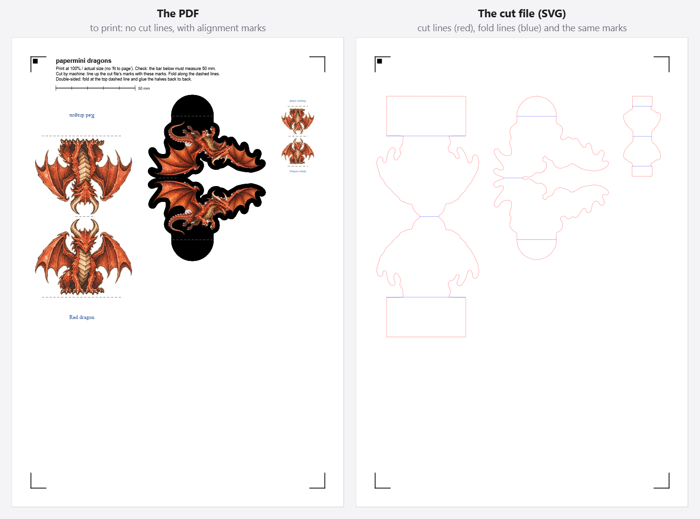

In the app, **Print…** prints the sheet and **Export…** saves the files: tick
the PDF, the cut file or both. To cut, print the sheet at 100% (**Print…** does
this), load the cut file in your cutting software at its real size, and line up
its marks with the printed ones. How depends on the machine:

- **A machine that scans the sheet** (for example a Brother ScanNCut), or
  software that shows a scan or photo of it: place the cut file over the scan
  so its marks cover the printed marks. *Corners* marks work well for this.
- **Silhouette** (Cameo, Portrait): choose *Silhouette* marks. In Silhouette
  Studio, open the page settings, turn on registration marks with *Type 1*,
  *Length* 20 mm, *Thickness* 0.5 mm and *Inset* equal to the sheet's
  *Margin* (12 mm by default), and place the cut file at the top-left corner of
  the page. Studio's marks then cover the marks in the cut file, and its sensor
  reads the printed ones. papermini draws these marks to those measurements;
  check one sheet before cutting a batch, because Studio versions differ.
- **Cricut**: Print Then Cut only reads the marks that Cricut Design Space
  prints itself, so it cannot use these. Upload the pieces' images to Design
  Space instead, or cut by hand.

Pick paper that fits your cutting mat: a 12 × 12 in mat takes A4, A5 and
Letter, and a 12 × 24 in mat also takes A3, Legal and Tabloid. With *Mat* set,
papermini warns when the paper is bigger than the mat.

## How it works

1. **Segmentation.** The model (RMBG-1.4 or BiRefNet) runs at 1024×1024 and its
   mask is scaled back to the image size. With `--crop`, the model only sees the crop, and the result is
   pasted into an empty full-size mask.
2. **Clean-up.** Threshold (`strength`), then morphological closing (`fill_gaps`), then **hole filling** (so
   translucent ghosts become solid), then keep the largest part (or every part,
   with `--keep-all`).
3. **Scale.** `px_per_mm = figure height in px / --height-mm`.
4. **Margin.** Grow the mask by the margin, blur, and re-threshold to get a smooth
   outline. The canvas is padded first, so a figure that touches the image edge
   still gets a rounded margin.
5. **Tab.** Centred under the middle of the figure's bottom 6 mm, with the fold
   1 mm above the lowest point. Inner corners are rounded, which only ever adds
   paper.
6. **Cut line.** The outer contour, simplified, then smoothed into cubic Béziers.
   Sharp corners such as the tab stay sharp. The artwork's transparency comes from
   the same path, so the picture and the line match exactly.
7. **Output.** The SVG, written with [svg.py](https://github.com/orsinium-labs/svg.py),
   has `width`/`height` in mm, a `viewBox` in mm, an `image#art` element,
   `line.fold` dashed lines, `text.label` and `path#cut`. The PDF is drawn with
   ReportLab in exact millimetres.

## Installing on Windows

Each release has a Windows installer (`papermini-…-windows-x64-setup.exe`) next
to the `.zip`:

- It installs papermini for your user only, in
  `%LocalAppData%\Programs\papermini`, without asking for administrator rights,
  and adds it to the Start menu. Optional: a desktop shortcut, and **Add
  papermini to PATH** to run its [commands](#commands) in any terminal.
- papermini then shows in **Settings → Apps** (Apps & features), where you can
  uninstall it. The uninstaller asks you to close papermini first if it is
  still running (its files cannot be removed while it runs). Before it removes
  anything, it asks whether to delete papermini's cache too: the downloaded
  models, masks and images in `~/.cache/papermini` (or `PAPERMINI_CACHE`). Keep
  it if you will install papermini again, so the models need not be downloaded
  again. It also removes papermini from your PATH and deletes its
  [logs](#logs-and-reporting-a-problem), and lists any files it could not
  remove, with their folder, so you can delete them yourself.
- The `.zip` is the same app without installing: unpack it anywhere and start
  `papermini.exe`. Both update themselves (see [Updates](#updates)).

## Updates

The downloaded app keeps itself up to date:

- **Checking.** A few seconds after it starts, at most once a day, papermini asks
  GitHub for the latest release. It sends nothing about you or your files: only
  a request for the latest release, named papermini and its version. Offline,
  the check fails quietly. **Check for updates…** (or **About papermini**) in the
  ☰ menu checks right away and shows the result in the About window.
- **Downloading.** With **Update automatically** on (the default; **Preferences… →
  Updates**), a new version
  is downloaded in the background. Otherwise the bar under the header says a new
  version is available, and **Update** in the About window downloads it, with
  its progress.
- **Checking the download.** Every release has a list of the SHA-256 checksums
  of its downloads, signed with papermini's release key. papermini only installs
  a download whose list carries that signature and whose checksum matches; an
  update that fails either check is refused.
- **Installing.** When the update is ready, the bar under the header says it is
  installed when you close papermini, with *Restart now*. After papermini has
  quit, a small helper replaces the app with the new version (and starts it
  again, after *Restart now*). Unsaved work is asked about first, as always.
  A papermini installed with the [Windows installer](#installing-on-windows)
  downloads the new installer instead and runs it silently, so its shortcuts and
  its entry in Apps & features stay up to date. papermini counts as installed
  when the installer's entry in Apps & features names its folder; other copies,
  such as an unpacked `.zip`, replace their own folder.
  The downloads wait in `~/.cache/papermini/updates` until then.

papermini can only replace itself when it may write to its folder (your own
folders, the installer's folder, or the usual Applications folder; `Program
Files` on Windows needs administrator rights). Otherwise, and when it runs from source, it shows the
new version with a link to its release page instead.

## Logs and reporting a problem

The desktop app keeps a log on your computer, so a problem can be traced and
reported. Nothing is sent anywhere: you decide what to attach to a report.

- **Where.** Each time papermini starts, it writes a new log file,
  `papermini-<date>-<time>-<process>.log`, in your system's log folder:
  - Windows: `%LOCALAPPDATA%\papermini\logs`
  - macOS: `~/Library/Logs/papermini`
  - Linux: `$XDG_STATE_HOME/papermini` (`~/.local/state/papermini` by default)

  **Open log folder** (☰ menu, or **Preferences… → Logging**) opens it, and the
  About window shows
  where it is. Logs older than 30 days are deleted when papermini starts, and the
  [Windows uninstaller](#installing-on-windows) deletes the folder. Clearing the
  cache keeps the logs. Copies of papermini running at the same time each write
  their own file.
- **What is in it.** The papermini version, your system, Python and Qt; what you
  do (opening, saving and exporting, adding and removing images, the model you
  pick, changes in Preferences, models and cache actions); model downloads and
  loads; update checks,
  downloads and installs; warnings papermini shows you; and every error, with the
  settings of the figure it happened to (those not at their default). Your home
  folder is written as `~`. Image files are named but their contents are never
  logged. With **Detailed log** on (**Preferences… → Logging**, until papermini
  closes) it
  also logs every settings change, as old → new values once the change settles,
  and each build with its time.
- **When something goes wrong.** An unexpected error shows *Something went
  wrong*: it is in the log, and you can keep working (save your project soon).
  *Show details* shows the technical details (the traceback) in a window you can
  enlarge, and *Copy details* copies them. An error while papermini starts offers
  *Quit* instead. If papermini closes because of a crash, it offers to report it
  the next time it starts, once; the crash is in a `.crash.log` file next to that
  session's log.
- **Report a problem…** (☰ menu, the error window and the crash offer) opens a new
  bug report on GitHub in your browser, with your papermini version, system and
  how papermini runs filled in (and the error's details, from the error window).
  It also opens the log folder and names the file to attach: the newest log, or
  the crash file and log of the session that crashed. Nothing is sent until you
  submit the report on GitHub.

## Caching and speed

The first run downloads the segmentation model (~176 MB for RMBG-1.4, 214 MB
or 928 MB for BiRefNet) into
`~/.cache/papermini/`; the desktop app asks before it downloads. You can change that folder with the `PAPERMINI_CACHE`
environment variable. After that, everything works offline, and each image takes
a few seconds on a CPU. AI model masks are cached on disk per image, crop and
model, so re-running with a different `--strength` or `--height-mm` skips the
model entirely (`--no-cache` turns this off). Images from links are kept in
`images/` in the same folder, so each link is downloaded only once. In the
desktop app, **Preferences… → Models and cache** shows how much space the models,
masks and images take, and clears them.

Within one run (and in the desktop app), every stage is also cached in memory:
the decoded image, the raw mask (from the AI model, the alpha channel or a mask
file), the cleaned mask, and the outline and cut line. A change only redoes the
stages it affects:

- **Cosmetic** (label, colors, line width, resolution): a fraction of a second.
- **Shape** (height, margin, smoothing, tab): about a second.
- **Mask clean-up** (strength, gap filling, keep-all): reruns the clean-up.
- **Model or crop**: reruns the AI model.

Small figures from very large images are processed at a bounded resolution
(about 600 dpi, twice the output's 300 dpi), so they stay fast.

## Tests

The tests use synthetic masks, so they need no model or download. They cover hole
filling, part filtering, mm scaling, margin width, tab placement, a single closed
cut path that never cuts into the drawing, figures touching the border,
double-sided symmetry, Bézier deviation, SVG output, sheet packing, PDF output,
the add and build commands, project round-trip and the app's log. If PySide6 is installed,
an offscreen smoke test of the GUI also runs, with its error window and problem
reports.
