# papermini reference

The full details behind the [README](../README.md): every command-line option,
the desktop app in depth, and how the pipeline works.

- [Desktop app](#desktop-app)
- [Settings guide](#settings-guide)
- [Commands](#commands)
- [Background removal models](#model-licence)
- [Stands and bases](#stands-and-bases)
- [Double-sided minis](#double-sided-minis)
- [Cutting by machine](#cutting-by-machine)
- [Color adjustments](#color-adjustments)
- [Updates](#updates)
- [Tips](#tips)
- [How it works](#how-it-works)
- [Caching and speed](#caching-and-speed)
- [Tests](#tests)

## Desktop app

- **Header.** Open and save on the left; the three steps of the workflow in
  the middle of the window (**1 Source**, **2 Miniature**, **3 Print sheet**);
  the ☰ menu on the right. The steps are in the order you usually work, but you
  can open any of them at any time. Export and print are in the step they
  belong to: **Export SVG…** at the bottom of the Miniature settings, **Print…**
  and **Export…** at the bottom of the Print sheet settings. The ☰ menu has
  them too, and holds everything else: new project, save as, export all SVGs, **View**
  (show or hide the side panels, zoom), the **theme** (follow the system, light
  or dark), **Models…** and about. Keyboard shortcuts work without opening the menu: Ctrl+O
  open, Ctrl+I add images, Ctrl+L add an image from a link, Ctrl+V paste images, Ctrl+S save,
  Ctrl+Shift+P print, Ctrl+E export SVG, Ctrl+P export the sheet,
  Ctrl+0 fit, Ctrl+1 actual size, Ctrl+B figure list, Ctrl+Alt+B settings.
- **Images.** PNG, JPG, WebP, BMP and TIFF. Besides files, an image can come
  from the web: paste its link (URL) into the bar at the top of the figure list
  and press Enter; you can also drag a picture from a browser onto
  the window, or copy it (or its link) and press Ctrl+V. A link is downloaded
  once into `~/.cache/papermini/images/`; the project keeps the link itself, so
  it still works on another computer. A link must point at the image, not at
  the web page that shows it: right-click the picture and copy its address.
- **Side panels.** Drag the dividers to resize the figure list and the settings,
  or drag them shut. The buttons in the bottom corners of the canvas hide and
  show them (filled = shown) and stay put while a panel is hidden.
- **Figures** (left). Each figure is a card with a thumbnail of the finished
  piece, its height and its **Amount**: how many of it go on the print sheet.
  Click − or + to change the amount, or click the number and type one; 0 leaves
  the figure off the sheet. In a narrow list the height gives way first, then
  the word *Amount*. Add images with the add-image button
  above the list, add one from the web by pasting its link into the link bar
  under it, or drop files or a project anywhere in the window. Drag to reorder; **Delete**
  removes the selected one. A new figure starts with the settings of the one
  that is selected.
- **Settings** (right). The options of the step you are on, in sections you
  can fold open and closed (the app remembers which). The
  [settings guide](#settings-guide) explains each of them:
  - **Source:** *Crop*, then *Background removal* (model, strength, gap
    filling, detached parts), then *Image adjustments* (greyscale,
    brightness, contrast, saturation, hue, and *Reset adjustments*; see
    [Color adjustments](#color-adjustments)).
  - **Miniature:** *Size* (figure height and width, image resolution), then
    *Back side*, *Outline and cut line* and *Tab*, with
    *Label* as an indented sub-group at the end of *Tab* (the label is
    printed on the tab). *Back side*, *Tab* and *Label* each have a checkbox
    at the right of their header that turns the whole group on or off
    (*Print a back side*, *Print a tab*, *Print a label*); all three are on
    by default. A group that is off shows only its header and cannot be
    opened; turning the tab off also hides *Label*. **Export SVG…** at the
    bottom saves this figure's piece as an SVG.
  - **Print sheet:** instead of a figure's settings, the sheet's own: *Paper
    and layout* (paper, title, margin, gap) and *Cutting* (by hand, or by
    [cutting machine](#cutting-by-machine), with its bleed, marks and fold
    lines), then how many pieces and pages there are, **Print…** and
    **Export…**.

  The settings side cannot be made narrower than its widest step needs, so
  no field or checkbox is ever cut off; drag it shut to hide it instead.

  The preview updates about a second after each change, and fast series of
  changes (holding an arrow key) only build the final value. The model only
  runs once per image and crop. Changing an *Amount* only updates the sheet.
  Number fields step with the arrow keys, or the mouse wheel once you click
  into them, so scrolling the panel never edits values. Decimals use a point
  (`1.6`) whatever your system's language; a typed comma becomes a point.
  The *Apply … to all figures* button copies the settings of the step you are
  on to every other figure, except the crop, mask file, label and amount.
- **1 Source.** The original image with the outline that background removal
  found, before any margin or tab (those belong to the miniature). Everything
  outside the outline is faded, so you can spot a clipped sword tip or a
  detached part that was dropped. A legend in the bottom-left corner explains
  the outline, the faded background and the crop box. Crop first: drag a box on the image and the
  model only looks inside it, which helps a lot with busy backgrounds.
  Afterwards:
  - drag its **handles** (corners and edge midpoints, or anywhere along an
    edge) to resize it;
  - drag **inside** it to move it;
  - drag **outside** it to draw a new box;
  - press **Delete** or **Clear crop** (next to the zoom controls) to clear it,
    or **Esc** to cancel a drag;
  - press **Ctrl+Z** to undo a crop change (one at a time, also for another
    figure, which is then selected).

  Until there is a crop box, a hint above the image says to drag one, and dashed
  guide lines through the mouse show where it would start. Over a box, the part
  a drag would grab lights up: a handle, an edge, or the whole box. A click, or
  a press that barely moves, changes nothing, so it never starts the model by
  accident.

  The mouse wheel zooms and the middle mouse button pans.

  While a model runs, the image is dimmed and a card shows the model and how
  long it has been running, with **Cancel**. Cancel stops the model right
  away, also while it is still loading (the first run of a model loads it,
  which can take longer than the run itself). The figure then waits until you
  press **Run again** or change the image, crop or model; other settings, such
  as the margin, do not start the model again. A new crop or model also stops
  a run that is no longer needed, so a misclick on a slow model (BiRefNet)
  costs nothing. The app runs one model at a time: a figure that waits for
  another figure's model (an image you just added, say) shows a card with that
  figure's name, and its Cancel stops that run so the selected figure goes
  next. New images take the settings of the selected figure, model included.
- **2 Miniature.** The piece as it will print, with a 10 mm scale bar. The
  zoom controls at the bottom right zoom, fit (Ctrl+0), or show the piece at
  real size (*1:1*, Ctrl+1), depending on the DPI your screen reports.
- **3 Print sheet.** A live preview of the sheet as it prints, with the
  sheet's settings beside it. **Print…** (or
  Ctrl+Shift+P) prints the sheet straight away, without saving a PDF first.
  It always prints at real size, from the corner of the paper, on the sheet's
  paper (A4 or Letter); the app warns if the printer is set to another paper
  size. With several pages you can pick which to print.
- **Exporting.** **Export…** (Ctrl+P) opens a small dialog: the folder, the
  name (the sheet's title to start with) and what to save, each with the exact
  file names: the sheet to print (PDF) and, cut by machine, the cut file (one
  SVG per page). It remembers what you ticked, so after printing from the app,
  saving only the cut file is one click; it asks before replacing files.
  Anything that still needs building is built in the background first; the
  window stays responsive and you can cancel.
- **Model downloads.** The first time a figure needs a model that is not on
  this computer yet, the app asks first: it shows the model, its download size,
  where it comes from, where it will be kept and its licence. *Download* shows
  the progress and can be cancelled; *Not now* leaves the figure with a note,
  and the app does not ask again until you pick another model.
- **Models…** (☰ menu). Every built-in model with its licence, whether it is
  downloaded, its size and file name, and the folder it is kept in (*Open
  folder*). *Download* or *Download again* (to replace a damaged file), and
  *Delete* to free disk space.
- **Check for updates…** and **About papermini** (☰ menu) open the About window,
  which shows the version and checks for a newer one; **Update automatically**
  turns the daily check and background download on or off. See
  [Updates](#updates).

Projects are saved as **batch YAML** files, the same format as
`papermini batch`, so anything set up in the app can be rebuilt from the
command line.

## Settings guide

Every setting in the app, in the order of the settings panel. Each one shows:

- its name, as in the app;
- its command-line flag (for `papermini make`, unless another command is
  named) and its default value in brackets;
- what it does, in one line;
- more detail or an example.

The pictures show the same dragon with different values.

### Step 1, Source

#### Crop

##### Area
`--crop x0,y0,x1,y1` [whole image]\
The part of the image that background removal looks at.

Drag a box on the image, and anything outside it is left out. That helps a lot
with a busy background, or with a figure that shares its picture with
something else. *Clear* goes back to the whole image. On the command line the
box is given as fractions (0–1) or pixels. On this stat block, a box around
the dragon leaves out the text and the corner ornament:

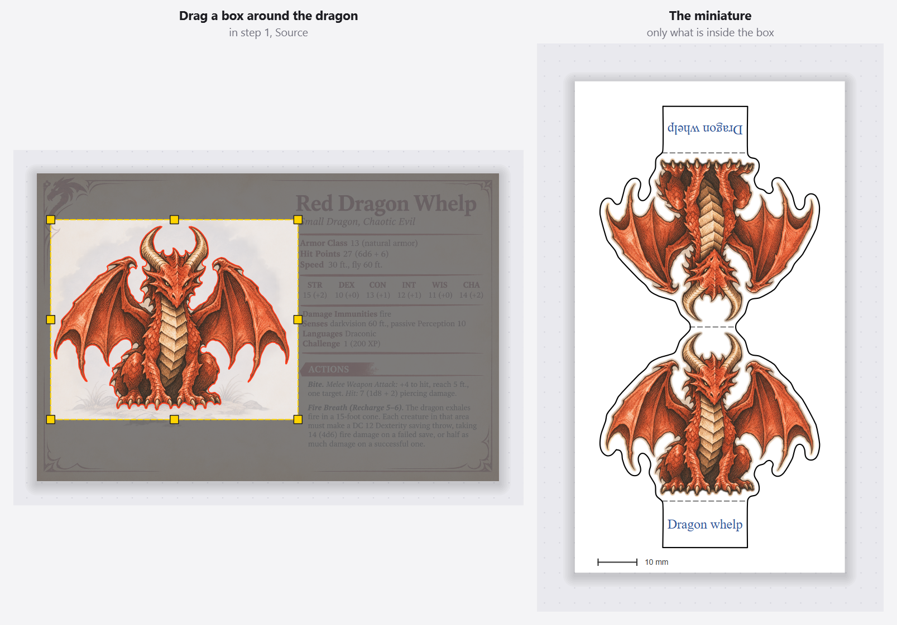

#### Background removal

##### Model
`--model` [auto]\
How the figure is cut out of its background.

*Auto* uses the image's own transparency when it has some, and rmbg-1.4
otherwise; a box under it says *Chosen method:* and which one it used for the
selected figure. *Mask image file* uses a mask you painted yourself (see *Mask image
file*). The first time a model is needed, the app asks before downloading it;
after that, papermini works offline. **Models…** in the ☰ menu shows which
models are downloaded, and where.

| Model | Download | Loading | Per image | Licence |
|---|---|---|---|---|
| rmbg-1.4 (default) | 176 MB | 1.1 s | 1.5 s | non-commercial use only |
| birefnet-lite | 214 MB | 10.4 s | 10.6 s | MIT |
| birefnet | 928 MB | 14.1 s | 21.0 s | MIT |

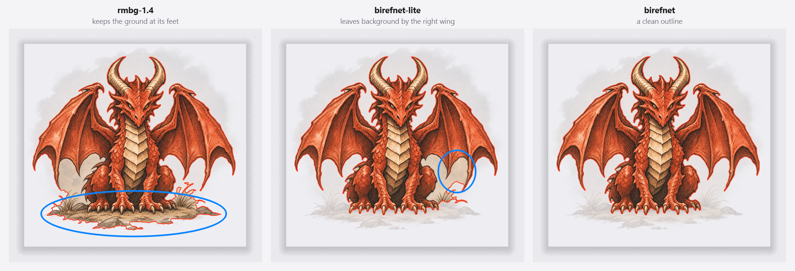

On this dragon, rmbg-1.4 is quick but keeps the ground at its feet,
birefnet-lite leaves a patch of background by the right wing, and birefnet
gives a clean outline. The circles mark what a model kept that birefnet
removed.

The times are for this image (1312 × 1199 pixels) on an Intel Core i7-4770K
from 2013, without the cache. A model loads once per session; the time per
image is the median of five runs. Results are cached, so an image is never
processed twice with the same crop and model. See
[Model licence](#model-licence) for the licences and the other model choices.

##### Mask image file
`--mask` [none]\
A black-and-white image that marks the figure, instead of a model.

Shown when *Model* is *Mask image file*. White is the figure and black the
background; the mask is stretched to the size of the picture. Use it when no
model gets a figure right, for example a faint sketch.

##### Strength
`--strength` [40]\
How sure the model must be that a pixel belongs to the figure (0–254).

Go lower when faint pencil lines or a thin sword get lost; go higher when bits
of background stay.

##### Gap filling
`--fill-gaps` [auto]\
Fills gaps and notches in the outline up to this many pixels.

For example the gap between a leg and a cloak, so the cut line does not dive
into it. *Auto* scales with the image: 9 px for a 1400 px image. 0 turns it
off.

##### Keep detached parts
`--keep-all` [off]\
Keeps every separate part of the figure, not only the largest.

Normally a speck or some text next to the figure is dropped. Turn this on for
a figure with a separate part, such as a floating staff or a spell effect:
every part is kept and joined to the figure with a 2.5 mm bridge.

##### Min. part area
`--min-area` [1000 px]\
With *Keep detached parts*: parts smaller than this are dropped as specks.

Raise it when dust or stray marks get joined to the figure; lower it when a
small part you want, such as a dagger, is dropped.

#### Image adjustments

These change the colors that are printed, never the outline, so they never
run the model again. **Reset adjustments** puts them all back, and a
double-click puts one slider back to 0. See
[Color adjustments](#color-adjustments).

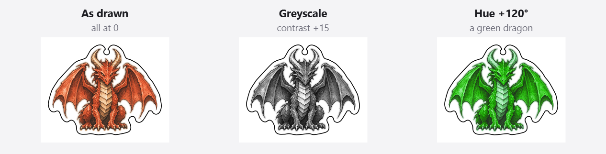

##### Greyscale (black and white)
`--greyscale` [off]\
Prints the figure in black and white.

Saves color ink, or gives a set of minis one look. Combine it with
*Contrast* for punchier lines.

##### Brightness
`--brightness` [0]\
Makes the picture lighter or darker (−100 to 100).

White paper stays white when you lighten, and black lines stay black when you
darken.

##### Contrast
`--contrast` [0]\
Makes lights lighter and darks darker, or flatter (−100 to 100).

A little extra contrast (10 to 20) can help a dull scan or a printer that
prints too pale.

##### Saturation
`--saturation` [0]\
Makes the colors stronger or weaker (−100 to 100).

−100 is grey and 100 twice as colorful.

##### Hue
`--hue` [0°]\
Turns every color around the color wheel (−180° to 180°).

Positive values go from red to yellow to green: +120 turns the red dragon
green, as in the picture above.

### Step 2, Miniature

#### Size

##### Figure height
`--height-mm` [42 mm]\
The height of the drawing itself, without the margin and the tab.

With the link button beside the size on (the default), the figure keeps its
proportions: set the height and the width follows.

##### Figure width
`--width-mm` [follows the height]\
The width of the drawing itself, without the margin.

Linked, setting the width sets the height. With the link button off, the
figure is stretched to both the height and the width.

##### Image resolution
`--dpi` [300 dpi]\
The resolution of the printed picture.

300 suits most printers; lower values make smaller files.

#### Back side

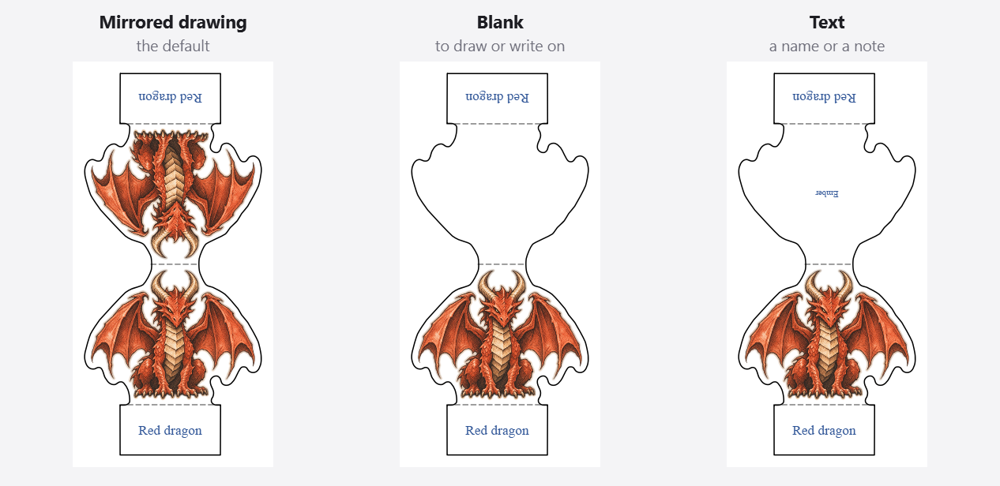

##### Print a back side
`--double-sided` / `--no-double-sided` [on]\
Prints the piece twice, joined at a fold above the head.

Fold it over and glue the halves back to back, so the figure looks right from
both sides. Off prints only the front. See
[Double-sided minis](#double-sided-minis).

##### Shows
`--back mirror|blank|text` [Mirrored drawing]\
What is on the back half.

*Mirrored drawing* is the figure seen from behind. *Blank* is plain paper in
*Color*, for example to draw on. *Text* is plain paper with *Text* on it. The
cut line is mirrored either way, so the halves always line up.

##### Color
`--back-color` [#ffffff (white)]\
The color of a blank or text back.

Shown when *Shows* is *Blank* or *Text*. The back's tab keeps the tab's fill
color.

##### Text
`--back-text` [the label]\
The text on a text back.

Shown when *Shows* is *Text*. It is centred on the body and sized as large as
fits; a long text wraps. On the sheet it is upside down, and it reads the
right way up once the piece is folded.

##### Text color
`--back-text-color` [#2f5597 (blue)]\
The color of the text on a text back.

Shown when *Shows* is *Text*.

#### Outline and cut line

##### Margin
`--margin-mm` [1.6 mm]\
The distance between the drawing and the cut line.

A wider margin is easier to cut with scissors and keeps thin points, such as
claws and horn tips, stronger.

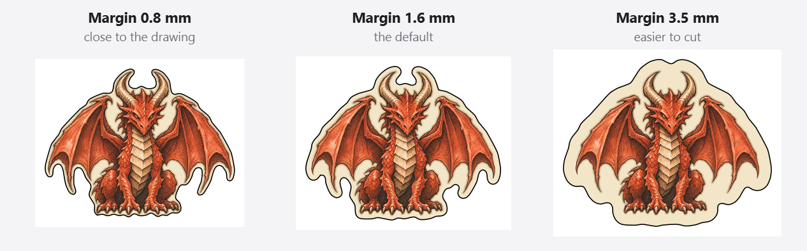

##### Margin fill type
`--margin-fill color|image` [Color]\
What fills the margin: one color, or the original image.

*Original image* shows the picture around the figure in the margin, as it is
in the image.

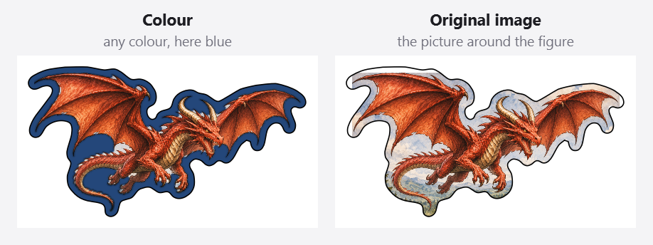

##### Margin fill color
`--margin-color` [#ffffff (white)]\
The color of the margin.

Shown when *Margin fill type* is *Color*. A dark margin hides a cut that is a
little off, as on the printed dragon at the top of the README.

##### Outline smoothing
`--smooth-mm` [0.6 mm]\
How much the outline is rounded.

More smoothing gives a calmer line with fewer bends to cut, but it also pulls
the line closer to thin tips, which then lose their margin.

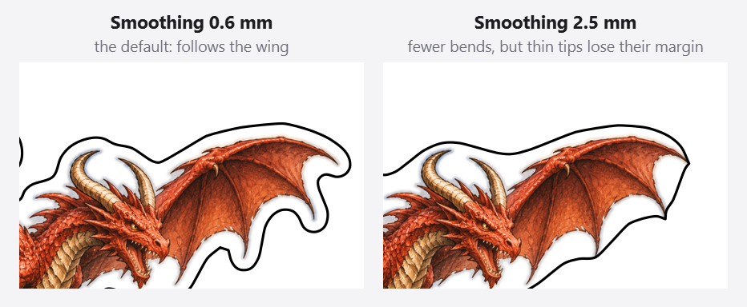

##### Straight segments only (no curves)
`--no-smooth` [off]\
Makes the cut line from straight lines instead of curves.

By default the SVG cut line uses smooth Bézier curves. Straight segments give
more points, for a program that handles only those.

##### Simplify
`--simplify-mm` [0.15 mm]\
How far the cut line may stray from the outline to use fewer points.

Higher values give fewer points and less detail; lower values follow the
outline more closely.

##### Color
`--cut-color` [#000000 (black)]\
The color of the printed cut line.

For cutting by hand. A sheet cut by machine prints no cut lines; its cut file
has them (see [Cut by](#cut-by) in the Print sheet step).

##### Width
`--cut-width-mm` [0.3 mm]\
The width of the printed cut line.

For cutting by hand: a thicker line is easier to follow with scissors.

#### Tab

The tab is the strip under the figure that folds back, so the figure stands
up. It folds at the dashed line. See [Stands and bases](#stands-and-bases).

##### Print a tab
`--no-tab` [on]\
Adds a tab under the figure.

Turn it off for a figure that goes into a slotted or magnetic base.

##### Shape
`--tab-shape square|round` [Square (stand)]\
A square tab for a stand, or a round one that folds out into a base.

*Square* slots into a stand or is glued onto a base. *Round* is a half disc
that folds outwards, so the figure stands on it. On a double-sided mini the
two half discs fold out to opposite sides and make a full circle.

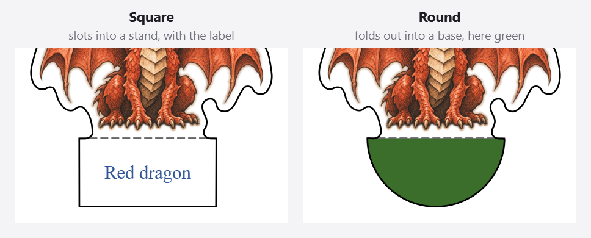

##### Width
`--tab-width-mm` [22 mm]\
The width of a square tab.

Match it to the slot of your stand.

##### Radius
`--tab-radius-mm` [12.5 mm]\
The radius of a round tab.

Shown when *Shape* is *Round*. 12.5 mm makes a 25 mm (one-inch) base; 25 mm
makes a 50 mm base for a large creature.

##### Height
`--tab-height-mm` [12 mm]\
How far a square tab reaches below the fold.

A taller tab holds better in a deep slot or gives more room to glue.

##### Overlap into figure
`--tab-overlap-mm` [0 mm]\
How far the tab reaches up past the fold, into the figure.

Without overlap, the tab is joined to the figure only where the figure itself
reaches the fold. That is fine for two feet planted wide, but when only the
tip of a tail or a single claw reaches down, that tiny strip is all that holds
the tab, and it tears when you fold it. An overlap adds paper beside it, up to
the figure, so the tab is held along its whole width. The app warns when only
a narrow strip holds the tab. Where the figure's bottom is already wider than
the tab, the overlap adds nothing, and the app says so.

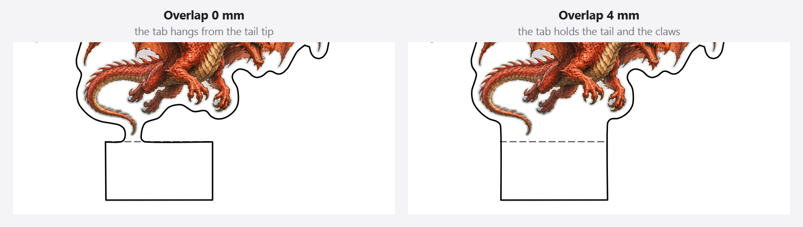

##### Fold above lowest point
`--fold-mm` [0 mm]\
Where the fold line is, measured up from the lowest point of the outline.

At 0 the fold is at the bottom of the margin, so the figure stands a margin's
height above the table. Set it to the margin (1.6 mm by default) to put the
fold right under the feet, so the figure stands on them. Everything below the
fold folds back with the tab and takes the tab's fill color; set it higher
and the feet fold back too. Leave it at 0 for a flying figure that has nothing
to stand on.

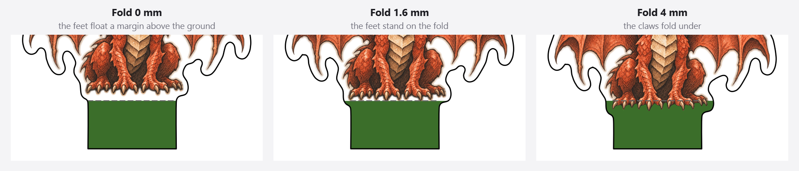

##### Fill color
`--tab-color` [#ffffff (white)]\
The color of everything below the fold, behind the label.

For example grass green or stone grey for a plain base, as on the round tab
above. It does not depend on the margin color.

#### Label

The label is text on the tab, in a sub-group at the end of *Tab*.

##### Print a label
`--label ""` [on]\
Prints a label on the tab.

Turn it off for a plain tab in its fill color. On the command line an empty
`--label ""` turns it off.

##### Text
`--label` [the file name]\
The text on the tab.

On a double-sided mini it is printed on both tabs. It is also the back text
when *Text* under *Back side* is empty.

##### Size
`--label-size-mm` [3.4 mm]\
The largest size of the label.

A long label shrinks to fit the tab.

##### Color
`--label-color` [#2f5597 (blue)]\
The color of the label.

Pick one that shows on the tab's fill color: a dark label on a dark tab
disappears.

### Step 3, Print sheet

The settings panel holds the sheet's own settings on this step. How many of a
figure go on the sheet is set on its card in the figure list:

##### Amount
`papermini sheet --copies` [1]\
How many of this figure go on the print sheet.

On each figure's card: click − or +, or click the number and type one. 0
leaves the figure off the sheet. In a project file it is `copies`.

#### Paper and layout

##### Paper
`papermini sheet --paper a4|letter` [A4]\
The paper size of the sheet.

The app warns when you print to a printer set to another paper size.

##### Title
`papermini sheet --title` [Paper miniatures]\
The title at the top of each page.

It is printed above the instructions for cutting and folding.

##### Margin
`papermini sheet --margin-mm` [12 mm]\
The empty border around each page.

Keep it at least as wide as the edge your printer cannot print on. Cut by
machine, the alignment marks sit in the corners, this far from the paper edges.

##### Gap
`papermini sheet --gap-mm` [7 mm]\
The space between the pieces on the sheet.

A wider gap leaves more room for scissors between the pieces.

#### Cutting

##### Cut by
`papermini sheet --cut hand|machine` [By hand]\
How the pieces are cut: by hand, or with a cutting machine.

*By hand* prints the cut lines on the sheet, for scissors or a knife.
*Machine* prints the sheet without cut lines but with alignment marks, and
**Export…** can also save a cut file: an SVG with the cut lines and the same
marks, to load in your cutting machine's software. See
[Cutting by machine](#cutting-by-machine).

##### Bleed
`--bleed-mm` [1 mm]\
Prints the edge colors this far beyond the cut line.

Shown when *Cut by* is *Machine*. The margin, tab or back color goes on past
the cut line, so a machine cut that is slightly off never shows a white edge.
In a project file it is the sheet's `bleed_mm`; with `papermini make` it is
`--bleed-mm` (0 by default), for SVGs that go on a machine sheet.

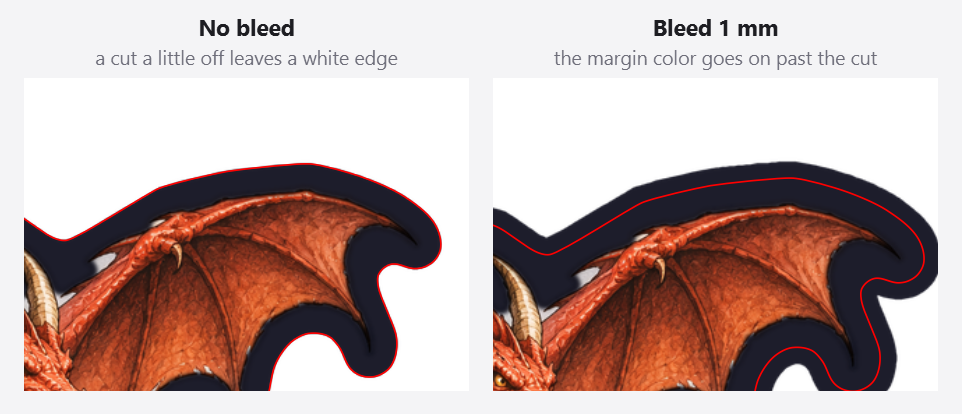

##### Marks
`papermini sheet --marks corners|silhouette|none` [Corners]\
The alignment marks on the sheet and in the cut file.

Shown when *Cut by* is *Machine*. *Corners* is an L in each corner and a
small square top-left, so the page cannot be lined up the wrong way round.
*Silhouette* copies Silhouette Studio's *Type 1* marks: a filled square
top-left and an L top-right and bottom-left. See
[Cutting by machine](#cutting-by-machine) for the settings to match in
Silhouette Studio. *None* leaves the marks out: the cut file is then lined up
with the page itself.

##### Fold lines in cut file
`papermini sheet --cut-folds` [off]\
Also puts the fold lines in the cut file.

Shown when *Cut by* is *Machine*. The fold lines go in their own group, in
blue, so the cutting software can score or draw them, or leave them out. They
are always printed on the sheet.

## Commands

### `papermini make IMAGE... [options]`

Makes one SVG per image, saved next to the image or in `-o DIR` (or
`-o name.svg` for a single image). An image can also be a link (an `http://` or
`https://` URL) to a PNG, JPG, WebP, BMP or TIFF on the web; it is downloaded
once and cached, and its SVG is saved in the current folder.

```bash
papermini make dragon.png --height-mm 42 --label "Red dragon"
```

```bash
papermini make boss.png --height-mm 56 --crop 0.08,0,0.92,0.62 --strength 60 --fill-gaps 7
```

```bash
papermini make *.png -o minis --debug
```

| option | default | meaning |
|---|---|---|
| `--height-mm` | 42 | height of the drawn figure, without margin and tab |
| `--width-mm` | | width of the drawn figure. Alone it sets the size by width (the proportions stay); with `--height-mm` the figure is stretched to both |
| `--margin-mm` | 1.6 | distance between the drawing and the cut line (filled as set by `--margin-fill`) |
| `--smooth-mm` | 0.6 | how much the outline is rounded |
| `--tab-shape` | square | `square` slots into a stand; `round` is a half disc that folds out into a base |
| `--tab-width-mm` / `--tab-height-mm` | 22 / 12 | square tab size (height measured below the fold) |
| `--tab-radius-mm` | 12.5 | round tab radius (12.5 makes a 25 mm base) |
| `--tab-color` | #ffffff | tab color (everything below the fold), behind the label; independent of the margin color |
| `--tab-overlap-mm` | 0 | how far the tab reaches up past the fold. It only adds paper where the figure's bottom is narrower than the tab (feet, a tail), to strengthen the joint; on a wide bottom it has no effect, and the app says so |
| `--fold-mm` | 0 | fold line distance above the silhouette's lowest point |
| `--no-tab` | | no tab |
| `--double-sided` / `--no-double-sided` | on | front plus back, joined at a top fold, with a tab at both ends; `--no-double-sided` prints the front only |
| `--back` | mirror | double-sided back: `mirror` (the drawing seen from behind), `blank` (white paper) or `text` |
| `--back-text` | label | text for `--back text`; auto-sized and wrapped to fit the figure |
| `--back-color` | #ffffff | color of a `blank` or `text` back |
| `--back-text-color` | #2f5597 | color of the back text |
| `--crop x0,y0,x1,y1` | | region the model looks at, as fractions (0–1) or pixels |
| `--strength` | 40 | background removal strength (0–254): how sure the model must be that a pixel is figure; go lower for faint pencil, higher for busy scenes |
| `--fill-gaps` | auto | fill gaps and notches in the outline up to this many px; 0 = off (auto ≈ 9 px at a 1400 px image) |
| `--keep-all` / `--min-area` | / 1000 | keep detached parts (≥ min-area px) and bridge them to the figure |
| `--margin-fill` | color | `color` fills the margin with `--margin-color`; `image` shows the original picture there |
| `--margin-color` | #ffffff | color of the margin around the drawing |
| `--greyscale` | | print in black and white |
| `--brightness` | 0 | −100 (towards black) to 100 (towards white); white paper stays white, black lines stay black |
| `--contrast` | 0 | −100 (flat grey) to 100 (hard) |
| `--saturation` | 0 | −100 (grey) to 100 (twice as colorful) |
| `--hue` | 0 | turn every color around the color wheel, −180 to 180 degrees (red → yellow → green for positive values) |
| `--label` | file name | text on the tab; `--label ""` for none |
| `--dpi` | 300 | resolution of the embedded artwork |
| `--simplify-mm` | 0.15 | cut line simplification tolerance |
| `--no-smooth` | | straight segments only (by default the cut line uses Bézier curves) |
| `--cut-color` / `--cut-width-mm` | #000000 / 0.3 | cut line style |
| `--bleed-mm` | 0 | print the edge colors this far beyond the cut line, for a sheet cut by machine (`papermini sheet --cut machine`) |
| `--debug` | | write intermediate masks and a red overlay preview to `debug/` |

### `papermini sheet SVG... [-o minis.pdf]`

Lays papermini SVGs out on pages. Each page has an instruction header and a
50 mm calibration bar. Pieces are packed in rows with 7 mm gaps and 12 mm page
margins, and extra pages are added as needed.

```bash
papermini sheet "minis/*.svg" --copies 2 --paper letter -o minis.pdf --preview
```

Options: `--copies`, `--paper a4|letter`, `--margin-mm`, `--gap-mm`, `--title`, and
`--preview` (also writes a PNG per page). The sheet only reads SVGs written by
papermini. An SVG that was re-saved in another editor may not load.

For a cutting machine, `--cut machine` leaves the cut lines off the PDF, adds
alignment marks (`--marks corners|silhouette`) and writes a cut file per page
next to it (`minis-cut.svg`, `minis-cut-2.svg` and so on); `--cut-folds` also
puts the fold lines in it. Make the SVGs with `papermini make --bleed-mm 1` for
a bleed. See [Cutting by machine](#cutting-by-machine).

```bash
papermini sheet "minis/*.svg" --cut machine --marks silhouette -o minis.pdf
```

### `papermini batch config.yaml`

Takes a list of images with per-image options and writes the SVGs plus a sheet.
See [examples/minis.yaml](../examples/minis.yaml):

```yaml
output: minis
sheet: {output: minis/sheet.pdf, paper: a4, copies: 1, preview: true}
defaults: {height_mm: 42, strength: 40, fill_gaps: 9}
figures:
  - image: dragon.png
    label: Red dragon
    copies: 2
  - image: boss-attic.jpg
    label: Acererak
    height_mm: 56
    strength: 60
    fill_gaps: 7
    crop: [0.08, 0, 0.92, 0.62]
```

The `sheet` also takes `title`, `margin_mm`, `gap_mm` and, for a
[cutting machine](#cutting-by-machine), `cut: machine` with `bleed_mm`,
`marks` and `cut_folds`; every figure is then built with the bleed.

An `image` can also be a link, such as `image: https://example.com/goblin.webp`.
It is downloaded once (later runs use the cached copy) and saved projects keep
the link.

The size is `height_mm`, `width_mm` or both. One of them keeps the figure's
proportions; both stretch it to that height and width. A figure that gives only
`width_mm` is sized by width, but `defaults` count too: with `height_mm` in
`defaults`, write `height_mm: null` in a figure to size it by width only.

[examples/dragons/samples.yaml](../examples/dragons/samples.yaml) builds the
sample outputs in [examples/dragons/samples](../examples/dragons/samples), four
ways to print the same dragon: a default (double-sided) mini, a single-sided
mini on a round colored base, a mini with back text, and a mini with a dark
margin and a green tab. Their sheet is
[samples-sheet.pdf](../examples/dragons/samples/samples-sheet.pdf).
[samples-machine.yaml](../examples/dragons/samples-machine.yaml) makes a sheet
cut by machine:
[machine-sheet.pdf](../examples/dragons/samples/machine-sheet.pdf) and its cut
file [machine-sheet-cut.svg](../examples/dragons/samples/machine-sheet-cut.svg).

```bash
papermini batch examples/dragons/samples.yaml
```

```bash
papermini batch examples/dragons/samples-machine.yaml
```

## Model licence

The default model, [BRIA RMBG-1.4](https://huggingface.co/briaai/RMBG-1.4), is
licensed for **non-commercial use only** (see its model card). For commercial
use, pick one of the [BiRefNet](https://github.com/ZhengPeng7/BiRefNet) models
([MIT licence](https://github.com/ZhengPeng7/BiRefNet/blob/main/LICENSE)), use
images with transparency (`alpha`), paint your own mask, or bring your own ONNX
model. Every model downloads once, without an account.

| `--model`              | what                                                        |
|------------------------|-------------------------------------------------------------|
| `auto` (default)       | the image's alpha channel if it has transparency, else `rmbg-1.4` |
| `rmbg-1.4`             | BRIA RMBG-1.4 (176 MB download), run with onnxruntime       |
| `birefnet`             | BiRefNet general: sharper edges and fine detail, but a 930 MB download and about 20× slower than RMBG-1.4 on a CPU (half a minute per image) |
| `birefnet-lite`        | BiRefNet general with a small backbone: 215 MB download, about 7× slower than RMBG-1.4 |
| `alpha`                | use the PNG's own transparency                              |
| `path/to/model.onnx`   | your own ONNX model with RMBG-1.4-style input (RGB, `x/255-0.5`) |

You can also skip segmentation and pass a mask you painted yourself:
`--mask hero_mask.png` (white = figure).

## Stands and bases

The tab under the figure comes in two shapes:

- **Square** (`--tab-shape square`, the default) is a straight tab to slot into
  a stand, such as a 3D-printed one, or to glue onto a base.
- **Round** (`--tab-shape round`) is a half disc that you fold outwards so the
  figure stands on it. On a double-sided mini, the front and back tabs fold out
  to opposite sides and together make a full round base. `--tab-radius-mm` sets
  its size; 12.5 (the default) gives a 25 mm, one-inch base.

Either shape has its own color, `--tab-color`. It is white by default,
independent of the margin color, and covers everything below the fold. The
label is printed on it; use `--label ""` for a plain tab, for example grass
green or stone grey.

```bash
papermini make dragon.png --tab-shape round --tab-radius-mm 12.5 --tab-color "#3b6e2a" --label ""
```

The margin around the drawing can be any color (`--margin-color "#f3e6c8"`)
instead of white, or show the original image (`--margin-fill image`).

## Double-sided minis

Minis are double-sided by default: the piece is printed twice, joined at a fold
above the head. Fold it over and glue the halves back to back, so the figure
looks right from both sides. The cut line is always mirrored, so the halves line
up. `--no-double-sided` (or unticking the checkbox in the *Back side* header,
at the top of the app's Miniature step) prints only the front. What shows on
the back is up to you:

- `--back mirror` (default) shows the drawing seen from behind.
- `--back blank` leaves the back plain, in `--back-color` (white by default),
  for example to write or draw on by hand.
- `--back text` shows a name or short note, centred on the body and sized as
  large as fits:

  ```bash
  papermini make dragon.png --back text --back-text "Red Dragon Whelp"
  ```

  Without `--back-text`, it uses the label. On the sheet the back text is upside
  down; it reads the right way up once the piece is folded.

## Color adjustments

Greyscale, brightness, contrast, saturation and hue change the colors of what
is printed: the drawing, a margin filled with the image (`--margin-fill image`)
and the mirrored back. They never change what background removal sees, so the
outline stays where it is and moving a slider never runs the model again; even
with BiRefNet the preview follows at once. In the app they are in *Image
adjustments* in step 1, and the Source view shows the adjusted picture (a
smaller preview on large photos; the print always uses the full image). Their
sliders have 0 in the middle, marked with a short line: the colored fill runs
from there to the handle, a drag that comes close to 0 snaps to it (typed values
are kept as they are), and a double-click puts a slider back to 0.

```bash
papermini make goblin.png --greyscale --contrast 15   # black and white, a bit punchier
papermini make goblin.png --hue 120 --saturation 20   # a green goblin from a red one
```

In a project file they are `greyscale`, `brightness`, `contrast`, `saturation`
and `hue`; *Apply source settings to all figures* in the app copies them along
with the background removal settings.

## Tips

- **Tune with `--debug`.** `debug/<name>_overlay.png` shows red for what will be
  cut away and light blue for the white margin. It also writes the masks from
  each step (`0_raw` → `5_cut`).
- **Faint pencil.** Lower `--strength` (for example 25–40) and raise `--fill-gaps` if
  the silhouette has gaps.
- **Busy background.** Use `--crop` around the figure and try `--strength 60`. A
  flat edge from the crop at the bottom is fine, because it sits on the tab.
- **Props lost.** Floating props are dropped by default. `--keep-all` keeps them
  and adds a bridge.
- **Printing.** Print a PDF at 100% / "actual size", never "fit to page"
  (the app's **Print…** does this for you). Measure the 50 mm bar to check.
- **Cutting machines.** Set the sheet's *Cut by* to *Machine*: see
  [Cutting by machine](#cutting-by-machine).

## Cutting by machine

Set *Cut by* to *Machine* in the Print sheet settings (`cut: machine` in a
project file, `papermini sheet --cut machine` on the command line). Then:

- **The PDF** is for printing. It has the pieces with a bleed (the edge colors
  go on 1 mm past the cut line), the fold lines and the labels, but no cut
  lines. Alignment marks sit in the corners, *Margin* (12 mm) from the paper
  edges. Nothing else comes within 6 mm of them: a piece that would moves along
  its row, and the header starts beside the top-left mark, so a machine sheet
  holds about as many pieces as one cut by hand.
- **The cut file** is for the cutting machine's software: an SVG the size of
  the page, in millimetres, with the cut line of every piece exactly where it
  is on the page, and the same marks in the same places. A sheet of several
  pages gets one per page: `NAME-cut.svg`, `NAME-cut-2.svg` and so on. Its
  groups are `registration` (the marks), `cut` (red hairlines) and, with *Fold
  lines in cut file*, `fold` (blue).

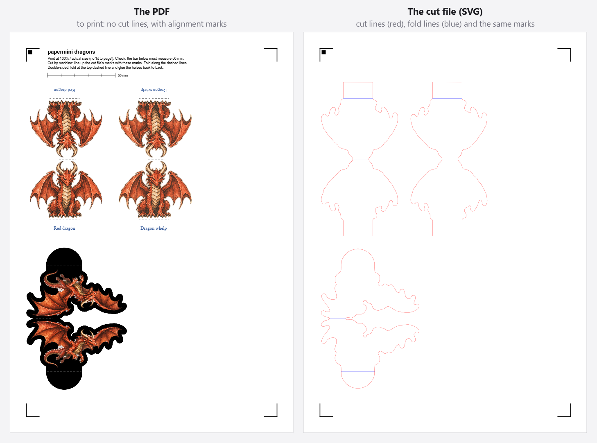

In the app, **Print…** prints the sheet and **Export…** saves the files: tick
the PDF, the cut file or both. To cut, print the sheet at 100% (**Print…** does
this), load the cut file in your cutting software at its real size, and line up
its marks with the printed ones. How depends on the machine:

- **A machine that scans the sheet** (for example a Brother ScanNCut), or
  software that shows a scan or photo of it: place the cut file over the scan
  so its marks cover the printed marks. *Corners* marks work well for this.
- **Silhouette** (Cameo, Portrait): choose *Silhouette* marks. In Silhouette
  Studio, open the page settings, turn on registration marks with *Type 1*,
  *Length* 20 mm, *Thickness* 0.5 mm and *Inset* equal to the sheet's
  *Margin* (12 mm by default), and place the cut file at the top-left corner of
  the page. Studio's marks then cover the marks in the cut file, and its sensor
  reads the printed ones. papermini draws these marks to those measurements;
  check one sheet before cutting a batch, because Studio versions differ.
- **Cricut**: Print Then Cut only reads the marks that Cricut Design Space
  prints itself, so it cannot use these. Upload the pieces' images to Design
  Space instead, or cut by hand.

## How it works

1. **Segmentation.** The model (RMBG-1.4 or BiRefNet) runs at 1024×1024 and its
   mask is scaled back to the image size. With `--crop`, the model only sees the crop, and the result is
   pasted into an empty full-size mask.
2. **Clean-up.** Threshold (`strength`), then morphological closing (`fill_gaps`), then **hole filling** (so
   translucent ghosts become solid), then keep the largest part (or every part,
   with `--keep-all`).
3. **Scale.** `px_per_mm = figure height in px / --height-mm`.
4. **Margin.** Grow the mask by the margin, blur, and re-threshold to get a smooth
   outline. The canvas is padded first, so a figure that touches the image edge
   still gets a rounded margin.
5. **Tab.** Centred under the middle of the figure's bottom 6 mm, with the fold
   1 mm above the lowest point. Inner corners are rounded, which only ever adds
   paper.
6. **Cut line.** The outer contour, simplified, then smoothed into cubic Béziers.
   Sharp corners such as the tab stay sharp. The artwork's transparency comes from
   the same path, so the picture and the line match exactly.
7. **Output.** The SVG has `width`/`height` in mm, a `viewBox` in mm, an `image#art`
   element, `line.fold` dashed lines, `text.label` and `path#cut`. The PDF is drawn
   with ReportLab in exact millimetres.

## Updates

The downloaded app keeps itself up to date:

- **Checking.** A few seconds after it starts, at most once a day, papermini asks
  GitHub for the latest release. It sends nothing about you or your files: only
  a request for the latest release, named papermini and its version. Offline,
  the check fails quietly. **Check for updates…** (or **About papermini**) in the
  ☰ menu checks right away and shows the result in the About window.
- **Downloading.** With **Update automatically** on (the default), a new version
  is downloaded in the background. Otherwise the bar under the header says a new
  version is available, and **Update** in the About window downloads it, with
  its progress.
- **Checking the download.** Every release has a list of the SHA-256 checksums
  of its downloads, signed with papermini's release key. papermini only installs
  a download whose list carries that signature and whose checksum matches; an
  update that fails either check is refused.
- **Installing.** When the update is ready, the bar under the header says it is
  installed when you close papermini, with *Restart now*. After papermini has
  quit, a small helper replaces the app with the new version (and starts it
  again, after *Restart now*). Unsaved work is asked about first, as always.
  The downloads wait in `~/.cache/papermini/updates` until then.

papermini can only replace itself when it may write to its folder (your own
folders, or the usual Applications folder; `Program Files` on Windows needs
administrator rights). Otherwise, and when it runs from source, it shows the
new version with a link to its release page instead.

## Caching and speed

The first run downloads the segmentation model (~176 MB for RMBG-1.4, 215 MB
or 930 MB for BiRefNet) into
`~/.cache/papermini/`; the desktop app asks before it downloads. You can change that folder with the `PAPERMINI_CACHE`
environment variable. After that, everything works offline, and each image takes
a few seconds on a CPU. AI model masks are cached on disk per image, crop and
model, so re-running with a different `--strength` or `--height-mm` skips the
model entirely (`--no-cache` turns this off). Images from links are kept in
`images/` in the same folder, so each link is downloaded only once.

Within one run (and in the desktop app), every stage is also cached in memory:
the decoded image, the raw mask (from the AI model, the alpha channel or a mask
file), the cleaned mask, and the outline and cut line. A change only redoes the
stages it affects:

- **Cosmetic** (label, colors, line width, resolution): a fraction of a second.
- **Shape** (height, margin, smoothing, tab): about a second.
- **Mask clean-up** (strength, gap filling, keep-all): reruns the clean-up.
- **Model or crop**: reruns the AI model.

Small figures from very large images are processed at a bounded resolution
(about 600 dpi, twice the output's 300 dpi), so they stay fast.

## Tests

The tests use synthetic masks, so they need no model or download. They cover hole
filling, part filtering, mm scaling, margin width, tab placement, a single closed
cut path that never cuts into the drawing, figures touching the border,
double-sided symmetry, Bézier deviation, SVG round-trip, sheet packing, PDF output,
the batch command and project round-trip. If PySide6 is installed, an offscreen
smoke test of the GUI also runs.
